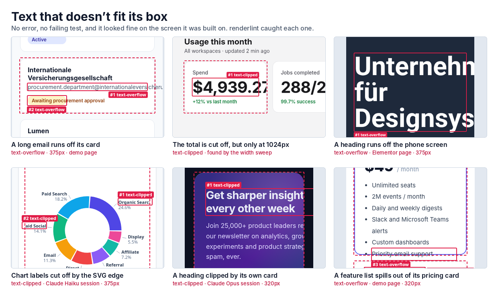
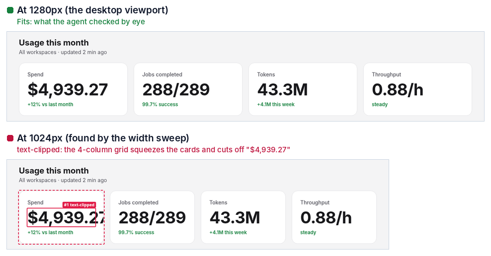
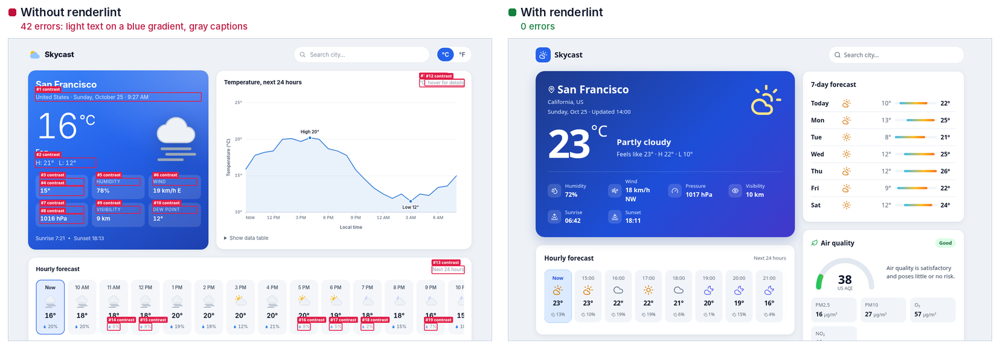
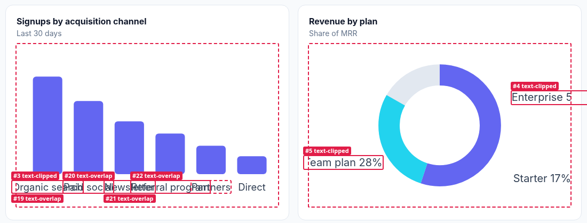
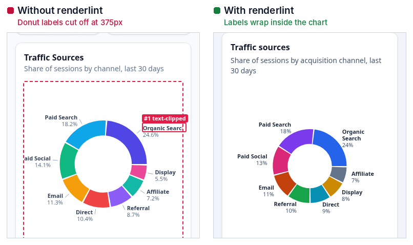
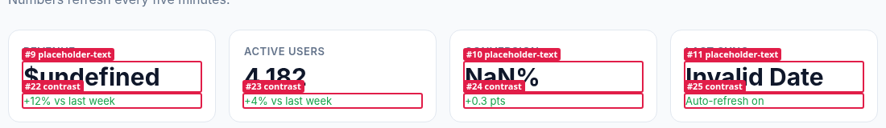
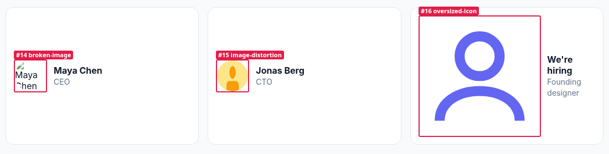
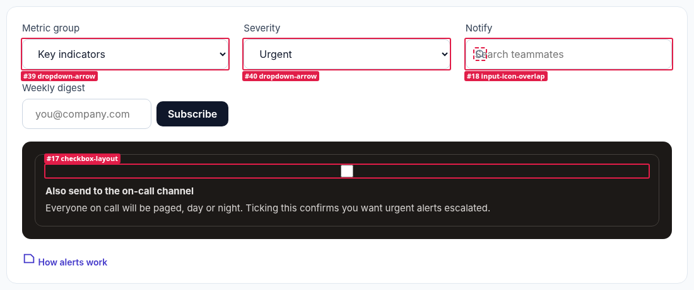
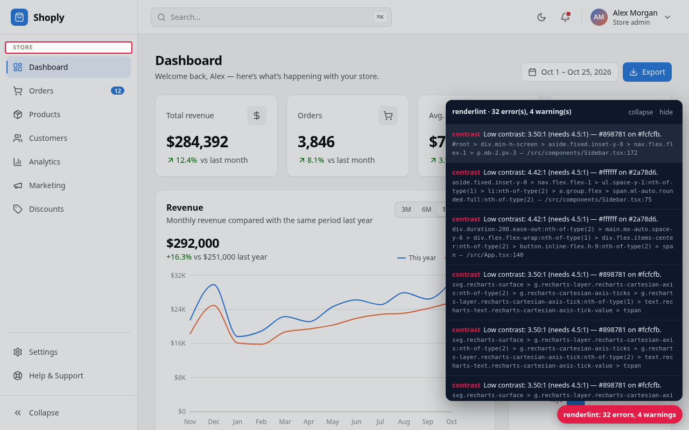

<h1 align="center">renderlint</h1>

<p align="center"><b>A linter for the rendered UI.</b> It opens your app in a real browser, finds the visual defects coding agents ship, and fails the build until they're fixed.</p>

<p align="center">
  <a href="https://github.com/ngocanhnckh/renderlint/actions/workflows/ci.yml"></a>
  <a href="LICENSE"></a>
  = 18.17">
  
</p>


<p align="center"><sub>Six times text didn't fit its box, each one renderlint's own annotated screenshot: from example pages, from apps Claude built in headless sessions, and from an Elementor page. More in the <a href="docs/gallery.md">gallery</a>.</sub></p>

Text spilling out of cards, gray-on-gray captions, chart labels on top of each other, a layout that only breaks at 1024px, a dropdown arrow jammed against the border, `$undefined` in a KPI tile, emoji where icons should be. TypeScript and ESLint can't see any of this, because the code is fine. It's the *pixels* that are wrong.

renderlint renders every page at phone, tablet and desktop widths (and dark mode), sweeps the widths in between, and re-checks with longer text, bigger numbers and longer API data. Each defect is reported with the element, the source file, an annotated screenshot and a concrete fix, in plain text an agent can act on.

## Quick start

**Paste this into your coding agent** (Claude Code, Cursor, Codex, Copilot, Gemini CLI, Windsurf, Aider, Zed, Amp…):

> Set up renderlint in this project: run `npx -y @ngocanhnckh/renderlint init`, then follow the "UI quality gate: renderlint" section it adds to AGENTS.md: after every UI change run `npx renderlint` and fix every reported error until it shows 0 errors.

Or run it yourself:

```bash
npx -y @ngocanhnckh/renderlint init   # one-time setup: installs it, adds config, build gate, agent instructions, Claude Code hook
npx renderlint                        # check: exits 1 if any error is found
```

Or just install it: `npm i -D @ngocanhnckh/renderlint`. The command is `renderlint` either way. To try it once without installing: `npx -y @ngocanhnckh/renderlint http://localhost:3000`.

```
✖ contrast (3)  Text does not have enough contrast with what is actually behind it …
  error Low text contrast: 2.66:1, needs 4.5:1 — #ffffff on a non-uniform background (≈#459bf4).
        at #top > section.hero > div.hero-copy > a.pill > b  "New"
        in Hero — src/components/Hero.tsx:42
        page / · all viewports · see .renderlint/screens/index@375.png #3
       fix use text #2e2e2e (currently #ffffff on #459bf4)

✖ text-clipped (1)  Text is partially cut off by an `overflow: hidden` container …
  error Text is cut off by an overflow:hidden container (12px past the right edge).
        at div.kpis > div.kpi:nth-of-type(1) > div.v  "$4,939.27"
        page /usage · at 1024px · see .renderlint/screens/usage@1024.png #1

✖ 4 error(s), 2 warning(s) · screenshots in .renderlint/screens
```

## Contents

- [What it catches](#what-it-catches)
- [Content you didn't render](#content-you-didnt-render)
- [How it compares](#how-it-compares)
- [Does it work?](#does-it-work)
- [See it](#see-it)
- [Pages behind a login](#pages-behind-a-login)
- [WordPress and Elementor](#wordpress-and-elementor)
- [Make it impossible to ship defects](#make-it-impossible-to-ship-defects)
- [Intentional? Say so.](#intentional-say-so)
- [Configuration](#configuration)
- [How it works](#how-it-works)
- [Limitations](#limitations)
- Docs: [rules](docs/rules.md) · [configuration](docs/configuration.md) · [integrations](docs/integrations.md) · [authentication](docs/authentication.md) · [WordPress](docs/wordpress.md) · [gallery](docs/gallery.md) · [results](docs/results.md)

## What it catches

37 rules, tuned so that a finding is almost always a real defect.

| What you see | renderlint rule |
|---|---|
| Longer text pokes out of a card, button or badge, or runs right up to its border | `text-overflow`, `text-clipped`, `text-crowding` |
| A layout that fits today's sample copy but breaks with real data | `fragile-layout` |
| Gray-on-gray or white-on-yellow text you can barely read | `contrast` (measured from real pixels, so it works on gradients and images) |
| Elements overlap when the window shrinks, instead of wrapping | `element-overlap`, `viewport-overflow`, `content-overflow` |
| Chart and diagram labels collide or get cut off | `text-overlap`, `text-clipped` (works on SVG charts) |
| A fixed header covers the hero, or a decoration covers a button | `obscured-content` |
| 🚀✨✅ emoji instead of a proper icon set | `emoji` (rendered DOM and source files) |
| `undefined`, `NaN`, `[object Object]`, `Invalid Date`, lorem ipsum | `placeholder-text` |
| Broken or stretched images, giant unsized SVG icons | `broken-image`, `image-distortion`, `oversized-icon` |
| A dropdown arrow on the border, a checkbox floating above its label, an icon over the placeholder, a squashed input | `dropdown-arrow`, `checkbox-layout`, `input-icon-overlap`, `squashed-control` |
| An input and its button at different heights, an icon sitting higher than its text | `control-height-mismatch`, `icon-misaligned` |
| Scroll-reveal sections that never appear on phones | `invisible-content` |
| No viewport meta, a pointless 3px scrollbar, `href="#"` links | `missing-viewport-meta`, `accidental-scrollbar`, `dead-link` |
| No focus ring, icon buttons with no label, tiny tap targets and text | `focus-indicator`, `unlabeled-control`, `tap-target`, `font-size-min` |
| Hydration errors, crashes, 404s, pages that only showed the login form | `page-error`, `console-error`, `broken-resource`, `auth-required` |

All rules, their defaults and fix guidance: [docs/rules.md](docs/rules.md). `npx renderlint explain <rule>` prints the same in the terminal.

## Content you didn't render

Most layout bugs show up with content nobody had on screen during development. renderlint generates those cases instead of waiting for production to find them:

| Check | What renderlint does |
|---|---|
| **Width sweep** | Re-runs the layout rules at 13 widths from 320 to 1920px and on both sides of every breakpoint the page uses, so a grid that only breaks at 1024px, or right above its `max-width: 900px` breakpoint, is caught (`@1024px` in the report, with its own screenshot). |
| **Longer text** | Lengthens every text by 50%. |
| **Long words** | Turns emails, URLs, domains and IDs into 36+ character strings with no break points. |
| **Big numbers** | Gives KPIs, prices and counters three more digits. |
| **Longer API data** | If the page fetched JSON, reloads it with longer names, titles and emails in every response. |
| **Declared worst cases** | `data-renderlint-maxlength="60"` or `data-renderlint-sample="…"` on an element tests exactly that content, and failures are errors. |
| **States and mocks** | `states` opens menus and dialogs, fills forms, or serves empty and failing API responses before checking. |



> [!TIP]
> When a field has a known limit, declare it: `<h3 data-renderlint-maxlength="60">{project.name}</h3>`. The attribute does nothing in production. See [docs/configuration.md](docs/configuration.md#content-you-didnt-render) for `states` and `mock`.

## How it compares

renderlint doesn't replace your other tools. It covers the gap between "the code is valid" and "the page looks right".

| | Reads | Catches overflow, overlap, clipping | Contrast over gradients and images | Needs a baseline | Tells you the fix |
|---|---|---|---|---|---|
| **ESLint, stylelint, TypeScript** | Source code | No | No | No | Yes, for code issues |
| **axe-core, Lighthouse** | DOM and computed CSS | No | Reported as "needs review" | No | Yes, for a11y rules |
| **Visual regression** (Percy, Chromatic, BackstopJS, Playwright screenshots) | Pixels, against approved images | Only as a diff from the baseline | Only as a diff | Yes: a defect in the first version becomes the baseline | No: shows *what changed*, not *what's wrong* |
| **renderlint** | Rendered geometry and pixels | Yes, at every width and with stressed content | Yes, from the real pixels behind each glyph | No | Yes: element, source file, screenshot and fix |

Visual regression testing is still the right tool for catching unintended *changes* to a design you've approved. renderlint catches defects in a page nobody has approved yet, which is what an agent produces every time.

## Does it work?

We ran 22 headless Claude Code sessions (Opus and Haiku), each building a typical frontend: landing pages, dashboards, a kanban board, a weather app, an SVG org chart and analytics charts, in HTML, React, Next.js, Vue and Svelte. Half of them also got the one-line setup prompt above.

- The **11 baseline apps had 229 errors** between them: mostly WCAG contrast failures, plus emoji icons and clipped chart labels.
- **All 11 apps built with renderlint finished at 0 errors**, because the agents fixed the issues themselves.
- Rescored later with the width sweep, the extra stress profiles and the form rules, the renderlint-built apps show **11 errors in 5 apps**. All of them are real and none were checkable at the time (9 only appear at 320–360px). The baselines show 225 errors.


<p align="center"><sub>The same weather-app prompt in two sessions. Left: no renderlint, 42 errors (its annotated report). Right: the session that ran renderlint and fixed its own findings.</sub></p>

Details, per-app numbers and lessons: [docs/results.md](docs/results.md).

## See it

Every run saves annotated screenshots with each finding boxed and numbered, so agents with vision (and humans) can see what's wrong.

<table>
<tr>
<td width="50%"><br><sub>Colliding bar-chart labels (<code>text-overlap</code>) and donut labels cut off by the SVG edge (<code>text-clipped</code>).</sub></td>
<td width="50%"><br><sub>A real Haiku session: donut labels clipped on phones, then fixed.</sub></td>
</tr>
<tr>
<td><br><sub>Leaked <code>$undefined</code>, <code>NaN%</code> and <code>Invalid Date</code> (<code>placeholder-text</code>).</sub></td>
<td><br><sub>Broken and squashed images, and an unsized 24×24 icon at 204px.</sub></td>
</tr>
</table>


<sub>Form controls that render but are built wrong: native select arrows on the border (<code>dropdown-arrow</code>), a checkbox stretched away from its label (<code>checkbox-layout</code>), a search icon over the placeholder (<code>input-icon-overlap</code>).</sub>

<p align="center"><br><sub>The Vite plugin's live overlay: hover a finding to highlight it. Each finding links to its component file and line.</sub></p>

More, including a deliberately broken [demo page](examples/demo/index.html) that triggers 22 rules: [docs/gallery.md](docs/gallery.md).

## Usage

Without config, `renderlint` works out what to check: a running dev server, then your `dev` script (started and stopped for you), then a build folder (`dist`, `build`, `out`…), then `index.html`. You can also point it at a target:

```bash
npx renderlint http://localhost:3000            # any running app
npx renderlint dist                             # a static build (served for you)
npx renderlint index.html about.html            # plain files
npx renderlint --serve "npm run preview" --url http://localhost:4173
npx renderlint --pages /,/pricing,/dashboard --viewports 360,768,1440
npx renderlint --sweep 1024,1366                # only these extra widths (--no-sweep to skip)
npx renderlint explain contrast                 # what a rule means and how to fix it
```

The output is plain text that agents can read. `--json`, `--format md` and `--format github` (PR annotations) are also available. Every run writes `.renderlint/report.json`, `.renderlint/report.md` and annotated screenshots to `.renderlint/screens/` (`--out <dir>` to change).

It doesn't care which framework you use. If it renders in a browser, renderlint can lint it: React, Next.js, Vue, Nuxt, Svelte/SvelteKit, Astro, Angular, Solid, Qwik, Remix, WordPress, plain HTML, and anything else.

## Pages behind a login

Without a session, an SPA sends every inner route to `/login`. renderlint reports those pages as `auth-required` instead of quietly checking the login form in their place. To check them, give it the token your route guard reads and mock the API: the inner pages render with nothing but the dev server running, and no credentials are involved.

```json
{
  "pages": ["/dashboard", "/accounts"],
  "auth": { "storage": { "sessionStorage": { "acme.token": "test-token" } } },
  "mock": { "**/api/me": { "name": "Dana" }, "**/api/accounts": "fixtures/accounts.json" }
}
```

It can also log in through your form once (`"auth": { "login": "/login", "user": "${RENDERLINT_USER}", "password": "${RENDERLINT_PASSWORD}" }`) or run a script for SSO. Hash routes (`/#/accounts`) are crawled as pages of their own, and log-out links are never followed. See [docs/authentication.md](docs/authentication.md).

## WordPress and Elementor

Run `init` in a theme or plugin folder, or point renderlint at any WordPress URL. It finds the local site (wp-env, LocalWP, DDEV, Lando, Docker Compose), crawls the real pages and skips wp-admin, feeds and login. It also scans your PHP templates. Findings in Elementor content name the widget and link straight to the editor:

```
  error Text spills outside its container (456px past the right edge).
        at div.elementor-element-99731bd > h1.elementor-heading-title  "Unternehmensberatung für Designsysteme"
        in Elementor heading 99731bd in page #12 — edit: http://localhost:8888/wp-admin/post.php?post=12&action=elementor
```

It also catches what's specific to WordPress sites:
- sections an entrance animation never revealed, usually because an optimisation plugin delays Elementor's JavaScript;
- Elementor's default widget texts, and WordPress sample content;
- Elementor's default global colors, which fail contrast.

Setup, logged-in and WooCommerce pages, CI with wp-env and Elementor fixes: [docs/wordpress.md](docs/wordpress.md).

## Make it impossible to ship defects

renderlint exits non-zero when it finds errors, so you can gate any step on it:

| Where | How |
|---|---|
| **`npm run build`** (any framework) | `init` appends a check to your build script, e.g. `"build": "vite build && renderlint dist"` or `"build": "next build && renderlint --serve \"npx next start -p 4319\" --url http://localhost:4319"` |
| **Vite** (React, Vue, Svelte, Solid, Preact, Lit, Qwik…) | `import renderlint from '@ngocanhnckh/renderlint/vite'` and add `renderlint()` to `plugins`. `vite build` fails on errors. In dev, an overlay shows findings live and prints them in the dev-server terminal, with source file:line. |
| **Claude Code** | `init` adds a `Stop` hook (`npx renderlint hook`). Claude can't end its turn while UI errors remain in files it changed. The hook only runs when UI files changed and gives up after 4 attempts, so it can't trap the agent. |
| **Other agents** | `init` writes the workflow into `AGENTS.md` (read by Codex, Cursor, Copilot, Gemini, Amp, Zed and others) and `CLAUDE.md`. |
| **CI** | `npx renderlint --format github` gives inline PR annotations. See [docs/integrations.md](docs/integrations.md). |
| **Any bundler, in dev** | `import('@ngocanhnckh/renderlint/client').then((m) => m.start())` adds the live overlay to any app. |

<details>
<summary><b>What <code>init</code> does</b></summary>

1. Adds renderlint as a dev dependency (creating a `package.json` for plain HTML sites).
2. Writes `renderlint.config.json`, pointed at your dev command or static folder.
3. Adds a `lint:ui` script and appends the check to `build`, so builds fail on UI defects (`--no-build` to skip).
4. Adds the agent workflow to `AGENTS.md`, and creates `CLAUDE.md` (which imports it) or adds the workflow to an existing one.
5. Installs the Claude Code Stop hook in `.claude/settings.json` (`--no-hook` to skip).
6. Adds `.renderlint/` to `.gitignore` and makes sure a headless Chromium is available.

`init` is idempotent, so you can run it again safely.
</details>

## Intentional? Say so.

Sometimes low contrast or clipped text is on purpose: a watermark, a teaser, a chat message containing emoji. Mark it the same way you'd write `!important` or `eslint-disable`:

```html
<div data-renderlint-ignore="emoji" data-renderlint-reason="user-generated chat">…</div>
<p data-renderlint-ignore>…</p>                          <!-- all rules, this subtree -->
```

```css
.watermark { --renderlint-ignore: contrast; }            /* works from CSS, inherits */
```

```js
const greeting = '👋 Welcome'; // renderlint-ignore emoji   (static source scan)
```

You can also ignore by selector or page in config: `"ignore": [{ "rule": "contrast", "selector": ".legal" }, { "rule": "dead-link", "page": "/blog/*" }]`.

> [!WARNING]
> An ignore is reviewed like an `eslint-disable`. The agent instructions tell agents to fix root causes first and to add a `data-renderlint-reason` whenever they ignore something.

## Configuration

`renderlint.config.json` (or `.js`/`.mjs`, or a `"renderlint"` key in `package.json`):

```json
{
  "serve": "npm run dev",
  "pages": ["/", "/pricing"],
  "viewports": [375, 768, 1280],
  "colorSchemes": "auto",
  "rules": { "line-length": "off", "tap-target": "error" },
  "ignore": [{ "rule": "contrast", "selector": ".legal-footnote" }],
  "states": [{ "name": "account menu", "click": "[aria-label=Account]", "waitFor": "[role=menu]" }],
  "mock": { "**/api/notifications*": [] }
}
```

All options, including the width sweep, stress profiles, states and mocks, crawling, WCAG AAA, timeouts and authenticated pages: [docs/configuration.md](docs/configuration.md).

## How it works

1. **Render.** Each page loads in headless Chromium at each viewport (and in dark mode if your CSS has `prefers-color-scheme: dark`). renderlint scrolls the page to trigger lazy content and scroll-reveal animations, waits for fonts and images, then jumps animations to their final state.
2. **Measure.** An analyzer runs in the page and checks geometry: the rects of every text run against its containers and clip boxes, box intersections, hit-testing (`elementsFromPoint`) for occlusion, and computed styles.
3. **Look at the pixels.** For contrast, the page is captured twice: once normally and once with all text made transparent. The second capture shows the real background behind each glyph, including gradients, images, translucent overlays and glass effects. Dropdown arrows are measured from pixels too, since the browser draws them outside the DOM.
4. **Stress.** The layout rules run again at the sweep widths, then with longer text, long words, bigger numbers, declared samples and longer API data. Anything that only breaks under stress becomes a `fragile-layout` warning.
5. **Report.** Findings are merged across viewports and pages, and repeats such as the same badge on 40 cards are grouped. Each is mapped back to a component or file where possible: React (including Server Components), Vue, Svelte and Astro dev builds. A fix hint and a numbered screenshot are attached.

It's tuned for a low false-positive rate. Things that are usually intentional are left alone: screen-reader-only text, `text-overflow: ellipsis`, `line-clamp`, closed accordions, off-canvas menus, carousels, scroll areas, overlapping avatar stacks, badges positioned outside cards, stacked-card illustrations, stretched links, modals and backdrops.

### Programmatic API

```js
import { check, formatPretty } from '@ngocanhnckh/renderlint';

const result = await check({ targets: ['http://localhost:5173'], config: { viewports: [390, 1440] } });
console.log(formatPretty(result));
process.exit(result.ok ? 0 : 1);
```

## Limitations

- `<canvas>` charts (Chart.js, ECharts in canvas mode) are pixels, so their labels can't be inspected. Use an SVG renderer, or rely on your chart library's own label-collision handling.
- Pages are checked as they load. Menus, dialogs, tabs and empty or error states are only checked when you list them in `states`, and pages behind a login need [`auth`](docs/authentication.md).
- Contrast follows WCAG 2 AA math. It doesn't model font weight beyond the large-text rule, and doesn't apply APCA.
- A single page takes about 4–10 seconds at three viewports with the sweep and stress passes. A site is faster per page: pages are checked side by side, and pages that render identically (an SPA's fallback route, duplicate URLs) share their checks. Use `--sweep 1024` or `--no-sweep` for a faster inner loop.

## Development

```bash
npm install
npm test                  # fixture suite: every rule must fire on its defect page and stay silent on clean pages
npm run build:client      # regenerate dist/ (browser bundle) after changing src/analyzer or src/client
node bin/renderlint.js test/fixtures/defects/contrast.html --no-crawl
```

See [CONTRIBUTING.md](CONTRIBUTING.md). MIT licensed.
