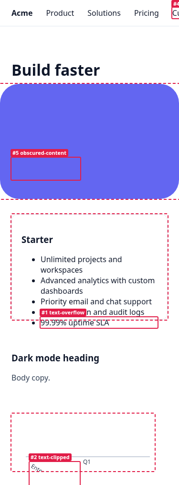

# renderlint

**A linter for the rendered UI.** It catches the visual mistakes that AI coding agents (and people) keep shipping: text spilling out of its box, unreadable contrast, overlapping chart labels, layouts that break on phones, emoji used as icons, leaked `undefined`/`NaN`. Your build fails until they're fixed, and the agent gets a precise report it can act on.

```
✖ contrast (3)  Text does not have enough contrast with what is actually behind it …
  error Low text contrast: 2.66:1, needs 4.5:1 — #ffffff on a non-uniform background (≈#459bf4).
        at #top > section.hero > div.hero-copy > a.pill > b  "New"
        in Hero — src/components/Hero.tsx:42
        page / · all viewports · see .renderlint/screens/index@375.png #3
       fix use text #2e2e2e (currently #ffffff on #459bf4)

✖ text-overflow (1)  Text spills outside the box (card, button, badge, input) that is supposed to contain it.
  error Text spills outside its container (153px past the right edge).
        at div.card > p  "Email: verylongemailaddress_without_breaks@enterprise-example.com"
        page /account · at 375px

✖ 4 error(s), 2 warning(s) · screenshots in .renderlint/screens
```

<p align="center"><br><sub>Every run saves annotated screenshots like this one, at 375px here, so agents with vision (and humans) can see each finding.</sub></p>

ESLint and TypeScript read your code. renderlint opens the page in a real headless Chromium at phone, tablet and desktop widths (plus dark mode when your CSS supports it). It measures what was actually painted, then reports each defect with the element, the component and source file when it can find them, an annotated screenshot, and a concrete fix.

It doesn't care which framework you use. If it renders in a browser, renderlint can lint it: React, Next.js, Vue, Nuxt, Svelte/SvelteKit, Astro, Angular, Solid, Qwik, Remix, plain HTML, and anything else.

---

## Paste this into your coding agent

> Set up renderlint in this project: run `npx -y github:ngocanhnckh/renderlint init`, then follow the "UI quality gate: renderlint" section it adds to AGENTS.md: after every UI change run `npx renderlint` and fix every reported error until it shows 0 errors.

This works in Claude Code, Cursor, Codex, Copilot, Gemini CLI, Windsurf, Aider, Zed, Amp and others. `init` does the rest (details [below](#what-init-does)). Once renderlint is published to npm, the command becomes `npx -y renderlint init`.

---

## Why

Agents are great at writing frontend code, but they can't see what they built. The same small defects show up again and again, and someone has to spot each one by eye:

| What you see | renderlint rule |
|---|---|
| Longer text pokes out of a card, button or badge, or touches its border | `text-overflow`, `text-clipped`, `fragile-layout` |
| Gray-on-gray or white-on-yellow text you can barely read | `contrast` (measured from real pixels, so it works on gradients and images) |
| Elements overlap when the window shrinks, instead of wrapping | `element-overlap`, `viewport-overflow`, `content-overflow` |
| 🚀✨✅ emoji instead of a proper icon set | `emoji` (rendered DOM and source files) |
| Chart and diagram labels collide or get cut off | `text-overlap`, `text-clipped` (works on SVG charts) |
| A fixed header covers the hero, or a decoration covers a button | `obscured-content` |
| `undefined`, `NaN`, `[object Object]`, `Invalid Date`, lorem ipsum | `placeholder-text` |
| Broken or stretched images, giant unsized SVG icons | `broken-image`, `image-distortion`, `oversized-icon` |
| Scroll-reveal sections that never appear on phones | `invisible-content` |
| No viewport meta, so the page is zoomed out on phones | `missing-viewport-meta` |
| A 3px overflow that adds a pointless scrollbar | `accidental-scrollbar` |
| `href="#"` buttons that go nowhere | `dead-link` |
| No focus ring, icon buttons with no label, tiny tap targets and text | `focus-indicator`, `unlabeled-control`, `tap-target`, `font-size-min` |
| Hydration errors and crashes | `console-error`, `broken-resource` |

See [docs/rules.md](docs/rules.md) for all 28 rules, their defaults and fix guidance.

## Does it work?

We ran 22 headless Claude Code sessions (Opus and Haiku), each building a typical frontend: landing pages, dashboards, a kanban board, a weather app, an SVG org chart and analytics charts, in HTML, React, Next.js, Vue and Svelte. Half of them got the one-line setup prompt above. The **11 baseline apps had 229 errors between them** (mostly WCAG contrast failures, plus emoji icons and clipped chart labels). **All 11 apps built with renderlint finished at 0 errors**, because the agents fixed the issues themselves. Details and lessons are in [docs/results.md](docs/results.md).

## Quick start

```bash
npx -y github:ngocanhnckh/renderlint init   # one-time setup
npx renderlint                              # check: exits 1 if any error is found
```

Without config, `renderlint` works out what to check: a running dev server, then your `dev` script (started and stopped for you), then a build folder (`dist`, `build`, `out`…), then `index.html`. You can also point it at a target:

```bash
npx renderlint http://localhost:3000            # any running app
npx renderlint dist                             # a static build (served for you)
npx renderlint index.html about.html            # plain files
npx renderlint --serve "npm run preview" --url http://localhost:4173
npx renderlint --pages /,/pricing,/dashboard --viewports 360,768,1440
npx renderlint explain contrast                 # what a rule means and how to fix it
```

The output is plain text that agents can read. `--json`, `--format md` and `--format github` (PR annotations) are also available. Every run writes `.renderlint/report.json`, `.renderlint/report.md` and annotated screenshots to `.renderlint/screens/`, with each finding numbered on the image.

## Make it impossible to ship defects

renderlint exits non-zero when it finds errors, so you can gate any step on it:

| Where | How |
|---|---|
| **`npm run build`** (any framework) | `init` appends a check to your build script, e.g. `"build": "vite build && renderlint dist"` or `"build": "next build && renderlint --serve \"npx next start -p 4319\" --url http://localhost:4319"` |
| **Vite** (React, Vue, Svelte, Solid, Preact, Lit, Qwik…) | `import renderlint from 'renderlint/vite'` and add `renderlint()` to `plugins`. `vite build` fails on errors. In dev, an overlay shows findings live and prints them in the dev-server terminal, with source file:line. |
| **Claude Code** | `init` adds a `Stop` hook (`npx renderlint hook`). Claude can't end its turn while UI errors remain in files it changed. The hook only runs when UI files changed and gives up after 4 attempts, so it can't trap the agent. |
| **Other agents** | `init` writes the workflow into `AGENTS.md` (read by Codex, Cursor, Copilot, Gemini, Amp, Zed and others) and `CLAUDE.md`. |
| **CI** | `npx renderlint --format github` gives inline PR annotations. See [docs/integrations.md](docs/integrations.md). |
| **Any bundler, in dev** | `import('renderlint/client').then((m) => m.start())` adds the live overlay to any app. |

### What `init` does

1. Adds renderlint as a dev dependency (creating a `package.json` for plain HTML sites).
2. Writes `renderlint.config.json`, pointed at your dev command or static folder.
3. Adds a `lint:ui` script and appends the check to `build`, so builds fail on UI defects (`--no-build` to skip).
4. Adds the agent workflow to `AGENTS.md`, and creates `CLAUDE.md` (which imports it) or adds the workflow to an existing one.
5. Installs the Claude Code Stop hook in `.claude/settings.json` (`--no-hook` to skip).
6. Adds `.renderlint/` to `.gitignore` and makes sure a headless Chromium is available.

`init` is idempotent, so you can run it again safely.

## Intentional? Say so.

Sometimes low contrast or clipped text is on purpose: a watermark, a teaser, a chat message containing emoji. Mark it the same way you'd write `!important` or `eslint-disable`:

```html
<div data-renderlint-ignore="emoji" data-renderlint-reason="user-generated chat">…</div>
<p data-renderlint-ignore>…</p>                          <!-- all rules, this subtree -->
```

```css
.watermark { --renderlint-ignore: contrast; }            /* works from CSS, inherits */
```

```js
const greeting = '👋 Welcome'; // renderlint-ignore emoji   (static source scan)
```

You can also ignore by selector or page in config: `"ignore": [{ "rule": "contrast", "selector": ".legal" }, { "rule": "dead-link", "page": "/blog/*" }]`.

## Configuration

`renderlint.config.json` (or `.js`/`.mjs`, or a `"renderlint"` key in `package.json`):

```json
{
  "serve": "npm run dev",
  "pages": ["/", "/pricing"],
  "viewports": [375, 768, 1280],
  "colorSchemes": "auto",
  "rules": { "line-length": "off", "tap-target": "error" },
  "ignore": [{ "rule": "contrast", "selector": ".legal-footnote" }]
}
```

All options, including crawling, stress factor, WCAG AAA, timeouts and waiting for selectors, are covered in [docs/configuration.md](docs/configuration.md).

## How it works

1. **Render.** Each page loads in headless Chromium at each viewport (and in dark mode if your CSS has `prefers-color-scheme: dark`). renderlint scrolls the page to trigger lazy content and scroll-reveal animations, waits for fonts and images, then jumps animations to their final state.
2. **Measure.** An analyzer runs in the page and checks geometry: the rects of every text run against its containers and clip boxes, box intersections, hit-testing (`elementsFromPoint`) for occlusion, and computed styles.
3. **Look at the pixels.** For contrast, the page is captured twice: once normally and once with all text made transparent. The second capture shows the real background behind each glyph, including gradients, images, translucent overlays and glass effects. Gradient or clipped text is measured from the ink pixels themselves.
4. **Stress test.** All text is lengthened by 50% and the layout re-checked. Anything that breaks becomes a `fragile-layout` warning, because real data is always longer than sample copy.
5. **Report.** Findings are merged across viewports and pages, and repeats such as the same badge on 40 cards are grouped. Each is mapped back to a component or file where possible: React (including Server Components), Vue, Svelte and Astro dev builds. A fix hint and a numbered screenshot are attached.

It's tuned for a low false-positive rate. Things that are usually intentional are left alone: screen-reader-only text, `text-overflow: ellipsis`, `line-clamp`, closed accordions, off-canvas menus, carousels, scroll areas, overlapping avatar stacks, badges positioned outside cards, stacked-card illustrations, stretched links, modals and backdrops.

## Programmatic API

```js
import { check, formatPretty } from 'renderlint';

const result = await check({ targets: ['http://localhost:5173'], config: { viewports: [390, 1440] } });
console.log(formatPretty(result));
process.exit(result.ok ? 0 : 1);
```

## Limitations

- `<canvas>` charts (Chart.js, ECharts in canvas mode) are pixels, so their labels can't be inspected. Use an SVG renderer, or rely on your chart library's own label-collision handling.
- renderlint checks the initial state of each page. Hover, open menus and states behind login need `beforeCheck` in a JS config (a function that receives the Playwright `page`).
- Contrast follows WCAG 2 AA math. It doesn't model font weight beyond the large-text rule, and doesn't apply APCA.

## Development

```bash
npm install
npm test                  # fixture suite: every rule must fire on its defect page and stay silent on clean pages
npm run build:client      # regenerate dist/ (browser bundle) after changing src/analyzer or src/client
node bin/renderlint.js test/fixtures/defects/contrast.html --no-crawl
```

See [CONTRIBUTING.md](CONTRIBUTING.md). MIT licensed.
