<h1 align="center">renderlint</h1>

<p align="center"><b>A linter for the rendered UI.</b> It opens your app in a real browser, finds the visual defects coding agents ship, and fails the build until they're fixed.</p>

<p align="center">
  <a href="https://github.com/ngocanhnckh/renderlint/actions/workflows/ci.yml"></a>
  <a href="https://github.com/ngocanhnckh/renderlint/releases/latest"></a>
  <a href="LICENSE"></a>
  = 18.17">
  
</p>

<p align="center">
  <a href="https://renderlint.yitec.net"><b>Website</b></a> ·
  <a href="https://renderlint.yitec.net/get-started/">Get started</a> ·
  <a href="https://renderlint.yitec.net/rules/">Rules</a> ·
  <a href="https://renderlint.yitec.net/examples/">Examples</a> ·
  <a href="https://renderlint.yitec.net/blog/">Blog</a> ·
  <a href="CHANGELOG.md">Changelog</a>
</p>

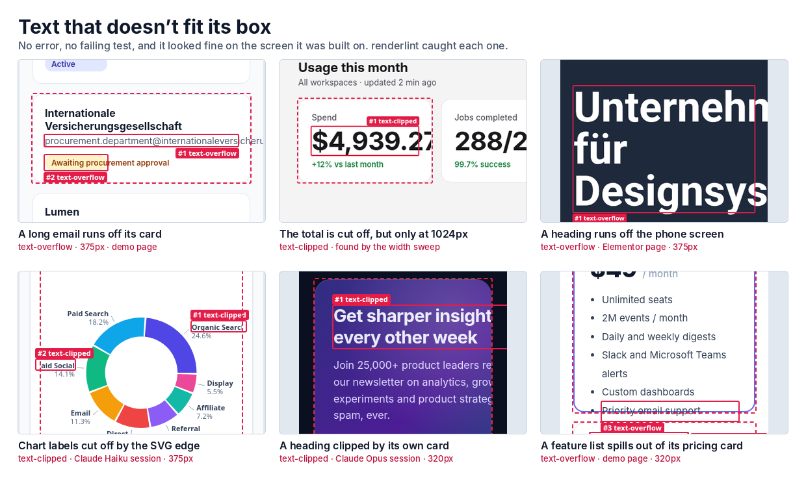
<p align="center"><sub>Six times text didn't fit its box, each one renderlint's own annotated screenshot. More in the <a href="docs/gallery.md">gallery</a>.</sub></p>

Text spilling out of cards, gray-on-gray captions, chart labels on top of each other, a layout that only breaks at 1024px, a tab you can't scroll, `$undefined` in a KPI tile, emoji where icons should be. TypeScript and ESLint can't see any of this, because the code is fine. It's the *pixels* that are wrong.

renderlint renders every page at phone, tablet and desktop widths (and dark mode), sweeps the widths in between, and re-checks with longer text, bigger numbers and longer API data. Each defect is reported with the element, the source file, an annotated screenshot and a concrete fix, in plain text an agent can act on.

## Fixed upstream

renderlint found these bugs on the websites and docs of popular open-source projects. Each fix was sent as a pull request and merged by the project's maintainers. Star and download counts update live.

<table>
<tr><th>Project</th><th align="left">Stars and downloads</th><th align="left">What renderlint found</th><th align="left">Fix</th></tr>
<tr><td align="center"><a href="https://ant.design"></a><br><a href="https://github.com/ant-design/ant-design"><b>Ant&nbsp;Design</b></a></td><td><a href="https://github.com/ant-design/ant-design"></a><br><a href="https://www.npmjs.com/package/antd"></a></td><td>Component pages scrolled sideways on phones: at 375px the Table page was 810px wide, because a media query built on a CSS variable never matched.</td><td><a href="https://github.com/ant-design/ant-design/pull/59920">#59920</a> (merged)</td></tr>
<tr><td align="center"><a href="https://mantine.dev"></a><br><a href="https://github.com/mantinedev/mantine"><b>Mantine</b></a></td><td><a href="https://github.com/mantinedev/mantine"></a><br><a href="https://www.npmjs.com/package/@mantine/core"></a></td><td>The Combobox transfer-list demo hid 218px of itself under the code panel at phone widths.</td><td><a href="https://github.com/mantinedev/mantine/pull/9447">#9447</a> (merged)</td></tr>
<tr><td align="center"><a href="https://ui.nuxt.com"></a><br><a href="https://github.com/nuxt/ui"><b>Nuxt&nbsp;UI</b></a></td><td><a href="https://github.com/nuxt/ui"></a><br><a href="https://www.npmjs.com/package/@nuxt/ui"></a></td><td>The team page scrolled sideways from 768px to about 850px and cut off the contribution counts.</td><td><a href="https://github.com/nuxt/ui/pull/7445">#7445</a> (merged)</td></tr>
<tr><td align="center"><a href="https://panda-css.com"></a><br><a href="https://github.com/chakra-ui/panda"><b>Panda&nbsp;CSS</b></a></td><td><a href="https://github.com/chakra-ui/panda"></a><br><a href="https://www.npmjs.com/package/@pandacss/dev"></a></td><td>The previous/next cards pushed most docs pages 97px sideways at 320px (flex items without <code>min-width: 0</code>).</td><td><a href="https://github.com/chakra-ui/panda/pull/4110">#4110</a> (merged)</td></tr>
</table>

How renderlint found them, and what the fixes were: [Layout bugs fixed in Ant Design, Mantine, Nuxt UI and Panda CSS](https://renderlint.yitec.net/blog/layout-bugs-fixed-ant-design-mantine-nuxt-ui-panda-css/).

## Quick start

**Paste this into your coding agent** (Claude Code, Cursor, Codex, Copilot, Gemini CLI, Windsurf, Aider, Zed, Amp…):

> Set up renderlint in this project: run `npx -y @yitec/renderlint init`, then follow the "UI quality gate: renderlint" section it adds to AGENTS.md: after every UI change run `npx renderlint` and fix every reported error until it shows 0 errors.

Or run it yourself:

```bash
npx -y @yitec/renderlint init   # one-time setup: installs it, adds config, build gate, agent instructions, Claude Code hook
npx renderlint                  # check: exits 1 if any error is found
```

To try it once without installing: `npx -y @yitec/renderlint http://localhost:3000`. Not sure what your app needs (a login, roles, server rendering, hundreds of pages)? [Getting started](docs/getting-started.md) picks the setup for your situation, and there's a page for each [framework](docs/frameworks/README.md).

```
✖ contrast (3)  Text does not have enough contrast with what is actually behind it …
  error Low text contrast: 2.66:1, needs 4.5:1 — #ffffff on a non-uniform background (≈#459bf4).
        at #top > section.hero > div.hero-copy > a.pill > b  "New"
        in Hero — src/components/Hero.tsx:42
        page / · all viewports · see .renderlint/screens/index@375.png #3
       fix use text #2e2e2e (currently #ffffff on #459bf4)

✖ text-clipped (1)  Text is partially cut off by an `overflow: hidden` container …
  error Text is cut off by an overflow:hidden container (12px past the right edge).
        at div.kpis > div.kpi:nth-of-type(1) > div.v  "$4,939.27"
        page /usage · at 1024px · see .renderlint/screens/usage@1024.png #1

✖ 4 error(s), 2 warning(s) · screenshots in .renderlint/screens
```

### Usage

Without config, `renderlint` works out what to check: a running dev server, then your `dev` script (started and stopped for you), then a build folder (`dist`, `build`, `out`…), then `index.html`. Or point it at a target:

```bash
npx renderlint http://localhost:3000            # any running app
npx renderlint dist                             # a static build (served for you)
npx renderlint --serve "npm run preview" --url http://localhost:4173
npx renderlint --pages /,/pricing,/dashboard --viewports 360,768,1440
npx renderlint --ux                             # also click through every page: feedback, errors, freezes
npx renderlint explain contrast                 # what a rule means and how to fix it
```

The output is plain text that agents can read; `--json`, `--format md` and `--format github` (PR annotations) are also available. Every run writes `.renderlint/report.json`, `.renderlint/report.md` and annotated screenshots to `.renderlint/screens/`.

It works with any framework that renders in a browser: React, Next.js, Vue, Nuxt, Svelte/SvelteKit, Astro, Angular, Solid, Qwik, Remix, WordPress, plain HTML.

## Contents

- [Fixed upstream](#fixed-upstream) · [What it catches](#what-it-catches)
- [See it](#see-it)
- [Loading states and the UX pass](#loading-states-and-the-ux-pass)
- [Content you didn't render](#content-you-didnt-render)
- [How it compares](#how-it-compares) · [Does it work?](#does-it-work)
- [Every page, every role, behind a login](#every-page-every-role-behind-a-login)
- [Make it impossible to ship defects](#make-it-impossible-to-ship-defects)
- [Adopting it on an existing app](#adopting-it-on-an-existing-app) · [Intentional? Say so.](#intentional-say-so) · [Configuration](#configuration) · [How it works](#how-it-works) · [Limitations](#limitations)
- Docs: [getting started](docs/getting-started.md) · [frameworks](docs/frameworks/README.md) · [rules](docs/rules.md) · [configuration](docs/configuration.md) · [authentication](docs/authentication.md) · [roles and coverage](docs/roles-and-coverage.md) · [server mocks](docs/server-mocks.md) · [Playwright](docs/playwright.md) · [Storybook](docs/storybook.md) · [integrations](docs/integrations.md) · [coding agents](docs/agents.md) · [WordPress](docs/wordpress.md) · [security](docs/security.md) · [results](docs/results.md)

## What it catches

63 rules, tuned so that a finding is almost always a real defect.

| What you see | renderlint rule |
|---|---|
| Longer text pokes out of a card, button or badge, or runs right up to its border | `text-overflow`, `text-clipped`, `text-crowding` |
| A layout that fits today's sample copy but breaks with real data | `fragile-layout` |
| A table or narrow column squeezed onto a phone so words break mid-word ("Ren-dered geom-etry") | `crushed-text` |
| Gray-on-gray or white-on-yellow text you can barely read | `contrast` (measured from real pixels, so it works on gradients and images) |
| Elements overlap when the window shrinks, instead of wrapping | `element-overlap`, `viewport-overflow`, `content-overflow` |
| Chart and diagram labels collide or get cut off | `text-overlap`, `text-clipped` (works on SVG charts) |
| Two layers that don't know about each other almost touching: a centred "No data yet" message drifting into a panel title pinned top-left | `text-near-overlap` (they collide at other widths) |
| A page or tab you can't scroll: content past an `overflow: hidden` app shell, a fixed-height card hiding the rest of its list, a dialog taller than a phone screen, a scroll lock left on | `unreachable-content` (renderlint turns the mouse wheel to make sure) |
| A fixed header covers the hero, or a decoration covers a button | `obscured-content` |
| A dropdown that opens behind the next card or is cut off by `overflow: hidden`; a tooltip that opens off the screen | `popup-obscured` (renderlint opens each menu and hovers each tooltip) |
| Buttons 2px apart, a label touching its button's border, a button jammed against its card's edge | `cramped-control` |
| A dropdown arrow on the border, a checkbox floating above its label, an icon over the placeholder, a squashed input, mismatched heights | `dropdown-arrow`, `checkbox-layout`, `input-icon-overlap`, `squashed-control`, `control-height-mismatch`, `icon-misaligned` |
| 🚀✨✅ emoji instead of a proper icon set | `emoji` (rendered DOM and source files) |
| `undefined`, `NaN`, `[object Object]`, `Invalid Date`, lorem ipsum | `placeholder-text` |
| Broken or stretched images, giant unsized SVG icons | `broken-image`, `image-distortion`, `oversized-icon` |
| `alert("Saved!")`, `confirm("Delete?")` instead of the app's own toast or modal | `native-dialog` |
| A card that stays blank while its data loads, then pops in; content that jumps when it arrives | `loading-state`, `layout-shift` |
| With `--ux`: a click with no response for a second, a failed save nobody is told about, a double submit, a dead button, a freeze, an empty list with no message, a modal that ignores Escape, a Back button that doesn't go back | `action-feedback`, `error-feedback`, `double-submit`, `dead-control`, `ui-freeze`, `slow-render`, `empty-state`, `dialog-focus`, `back-navigation` |
| Scroll-reveal sections that never appear on phones | `invisible-content` |
| No focus ring, focus hidden under a sticky header, icon buttons with no label, tiny tap targets and text, hover-only tooltips | `focus-indicator`, `focus-obscured`, `unlabeled-control`, `tap-target`, `font-size-min`, `tooltip-keyboard` |
| `aria-labelledby` pointing at a missing id; an `aria-label` that doesn't contain the visible text; no `<html lang>` | `aria-reference`, `label-in-name`, `html-lang` |
| Pinch-zoom turned off, form fields iPhones zoom into (text under 16px), a header under the iPhone notch or a tab bar under the home indicator | `zoom-disabled`, `input-zoom`, `safe-area` (renderlint emulates an iPhone's notch and home indicator) |
| No viewport meta, a pointless 3px scrollbar, `href="#"` links | `missing-viewport-meta`, `accidental-scrollbar`, `dead-link` |
| Hydration errors, crashes, 404s, pages that only showed the login form or "Access denied" | `page-error`, `console-error`, `broken-resource`, `auth-required`, `page-not-shown` |

All rules, their defaults and fix guidance: [docs/rules.md](docs/rules.md) or the [rules page](https://renderlint.yitec.net/rules/). `npx renderlint explain <rule>` prints the same in the terminal.

## See it

Every run saves annotated screenshots with each finding boxed and numbered, so agents with vision (and humans) can see what's wrong.

<table>
<tr>
<td width="50%">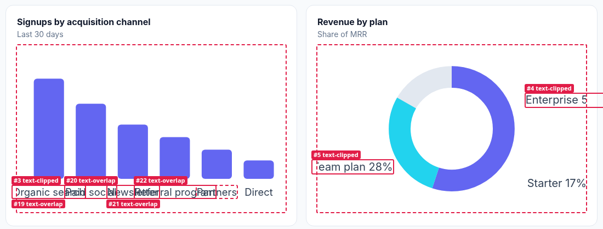<br><sub>Colliding bar-chart labels (<code>text-overlap</code>) and donut labels cut off by the SVG edge (<code>text-clipped</code>).</sub></td>
<td width="50%">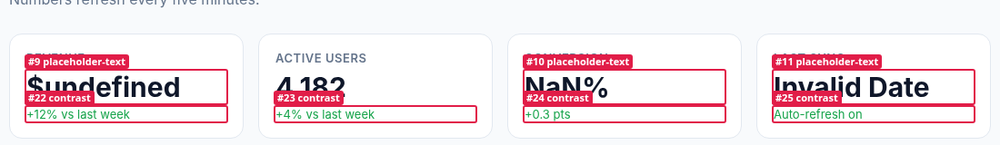<br><sub>Leaked <code>$undefined</code>, <code>NaN%</code> and <code>Invalid Date</code> (<code>placeholder-text</code>).</sub></td>
</tr>
</table>

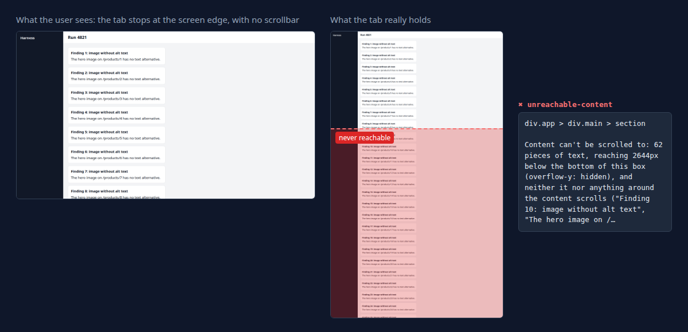
<sub>A tab inside a fixed-height app shell that never became a scroller: everything past the screen edge is painted but can't be reached (<code>unreachable-content</code>).</sub>

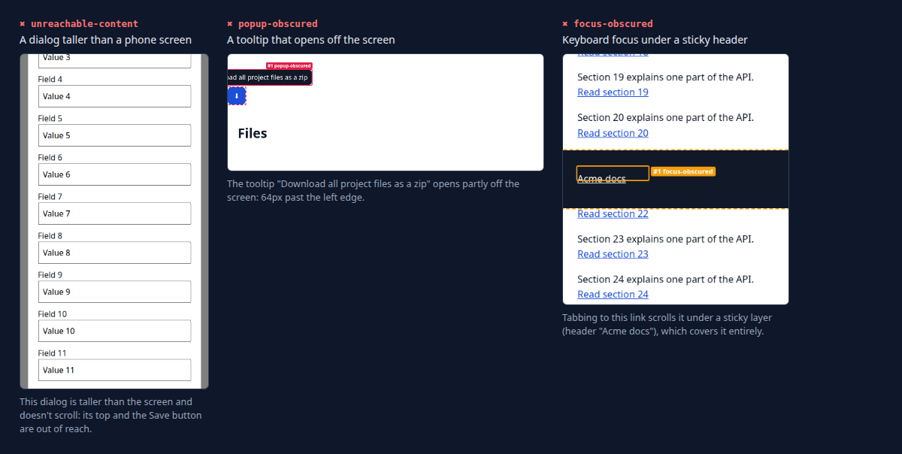
<sub>Found by driving the page: a dialog taller than a phone screen (<code>unreachable-content</code>), a tooltip that opens off the screen when hovered (<code>popup-obscured</code>), and a link that Shift+Tab scrolls under the sticky header (<code>focus-obscured</code>).</sub>

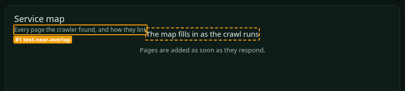
<sub>A centred empty-state message laid over a panel whose title is pinned top-left: 0px apart at this width, overlapping at narrower ones (<code>text-near-overlap</code>).</sub>

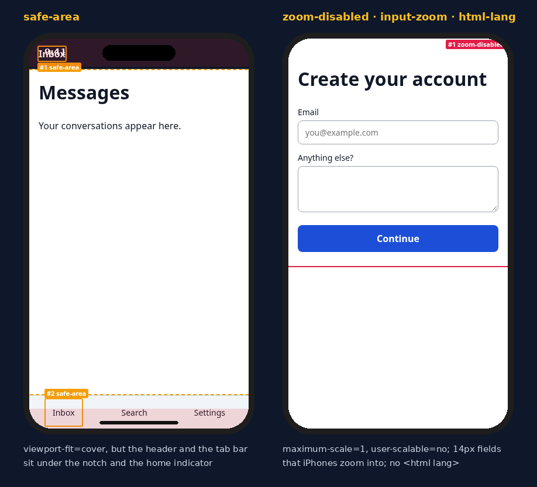
<sub>On phones: a header under the notch and a tab bar on the home indicator (<code>safe-area</code>; renderlint emulates the iPhone's insets), and a form that turns zoom off to hide that iPhones zoom into its 14px fields (<code>zoom-disabled</code>, <code>input-zoom</code>).</sub>

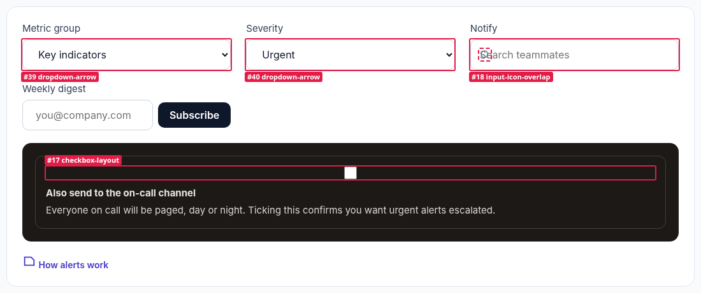
<sub>Form controls that render but are built wrong (<code>dropdown-arrow</code>, <code>checkbox-layout</code>, <code>input-icon-overlap</code>).</sub>

<p align="center">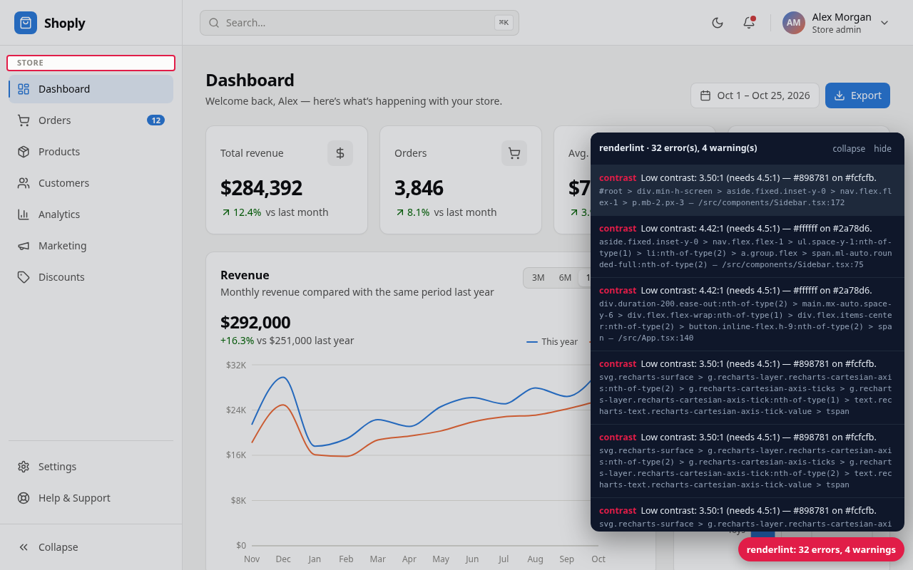<br><sub>The Vite plugin's live overlay: hover a finding to highlight it. Each finding links to its component file and line.</sub></p>

More in the [gallery](docs/gallery.md), on the [examples page](https://renderlint.yitec.net/examples/), and in a deliberately broken [demo page](examples/demo/index.html) that triggers 22 rules.

## Loading states and the UX pass

On a fast dev machine the API answers in 50ms, so a page with no loading state looks fine. On a phone on a train, the same page sits blank for three seconds and looks broken. renderlint shows you that page.

<table>
<tr>
<td width="50%">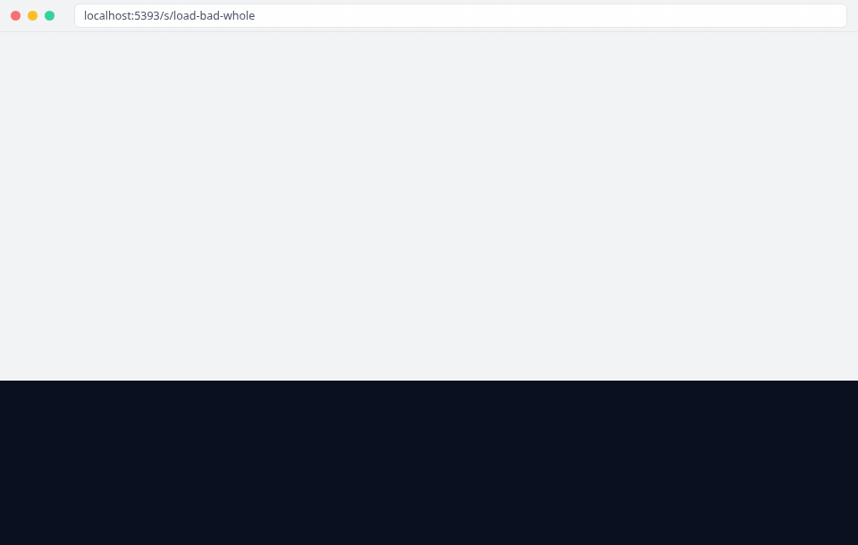<br><sub><code>loading-state</code>: nothing on screen while the data loads.</sub></td>
<td width="50%"><br><sub><code>ui-freeze</code>: the click blocks the page for 1.5s.</sub></td>
</tr>
<tr>
<td width="50%">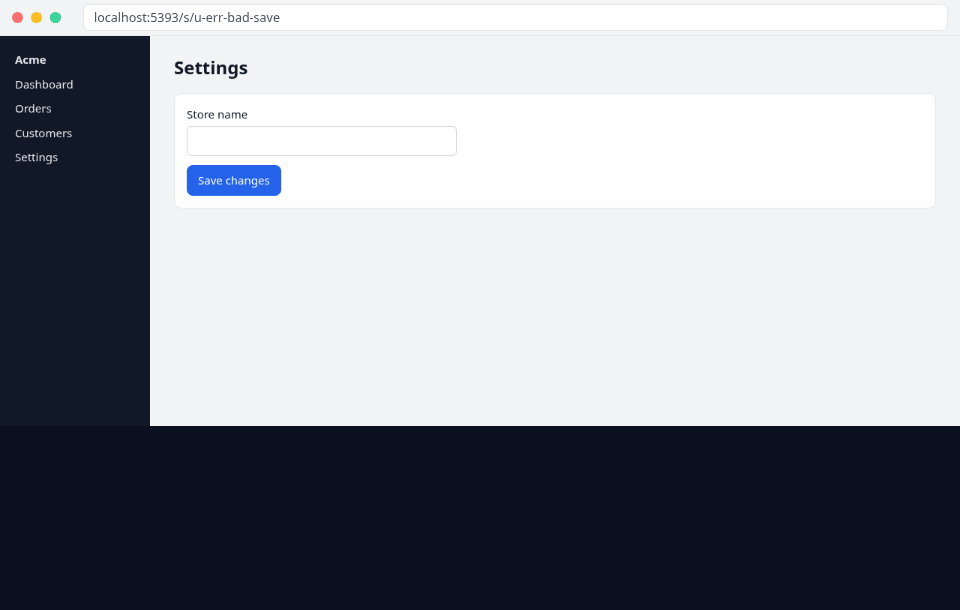<br><sub><code>error-feedback</code>: the save fails and nobody is told.</sub></td>
<td width="50%">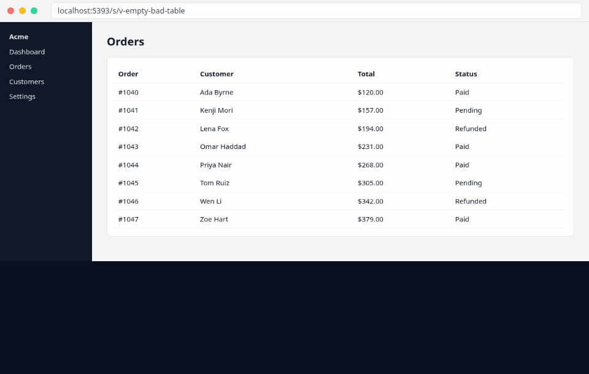<br><sub><code>empty-state</code>: a new account sees an empty table, no message.</sub></td>
</tr>
</table>

**Every run:** each page that loads data in the browser is reloaded with its `fetch`/XHR requests held for one second. An area the data later fills that showed nothing meanwhile is a `loading-state` warning. Any loading sign counts: a skeleton, a spinner (CSS, canvas or SVG), a progress bar, "Loading…" text, `aria-busy`, or anything moving on screen.

**`--ux`:** on each page, every kind of button, tab, in-app link, filter dropdown and form (filled with test data) is used on a fresh load:

| What happens | Rule | Threshold |
|---|---|---|
| The click starts a request, and nothing on screen changes for a second | `action-feedback` | 1s ([Nielsen](https://www.nngroup.com/articles/response-times-3-important-limits/)) |
| renderlint answers the request with HTTP 500, and nothing says so (or the spinner never stops) | `error-feedback` | |
| A second click while the first is pending sends the request again | `double-submit` | |
| The button does nothing visible: no request, no change, no navigation | `dead-control` | |
| The page can't respond or repaint | `ui-freeze` | 500ms ([INP "poor"](https://web.dev/articles/inp)) |
| The page's main content appears late | `slow-render` | 4s ([LCP "poor"](https://web.dev/articles/lcp)) |
| Content jumps when the data arrives | `layout-shift` | 0.1 ([CLS](https://web.dev/articles/cls)) |
| With every list in its API responses emptied (a new account), a list is just blank, spins forever, or the page crashes | `empty-state` | |
| A dialog leaves focus behind it, ignores Escape, or drops focus when it closes | `dialog-focus` | [WAI-ARIA dialog pattern](https://www.w3.org/WAI/ARIA/apg/patterns/dialog-modal/) |
| After an in-app link, Back skips the page or changes the address but not the page | `back-navigation` | |

Requests that change data (POST, PUT, PATCH, DELETE) are answered by renderlint with `200 {}` and never reach your server. Logout links and "Sign out" buttons are skipped.

On 75 dashboard pages (React with hooks, TanStack Query, React Router loaders, Suspense; XHR; plain HTML), 24 of them written by an agent that never saw the detector, renderlint caught every missing loading state and every click with no feedback, and never flagged a page that had one. See [docs/results.md](docs/results.md#loading-states-and---ux).

## Content you didn't render

Most layout bugs show up with content nobody had on screen during development. renderlint generates those cases instead of waiting for production to find them:

| Check | What renderlint does |
|---|---|
| **Width sweep** | Re-runs the layout rules at 13 widths from 320 to 1920px and on both sides of every breakpoint the page uses, so a grid that only breaks at 1024px is caught (`@1024px` in the report, with its own screenshot). |
| **Longer text** | Lengthens every text by 50%. |
| **Long words** | Turns emails, URLs and IDs into 36+ character strings with no break points. |
| **Big numbers** | Gives KPIs, prices and counters three more digits. |
| **Longer API data** | If the page fetched JSON, reloads it with longer names, titles and emails in every response. |
| **Declared worst cases** | `data-renderlint-maxlength="60"` or `data-renderlint-sample="…"` on an element tests exactly that content, and failures are errors. |
| **States and mocks** | `states` opens menus and dialogs or fills forms; `mock` serves empty or failing API responses. |

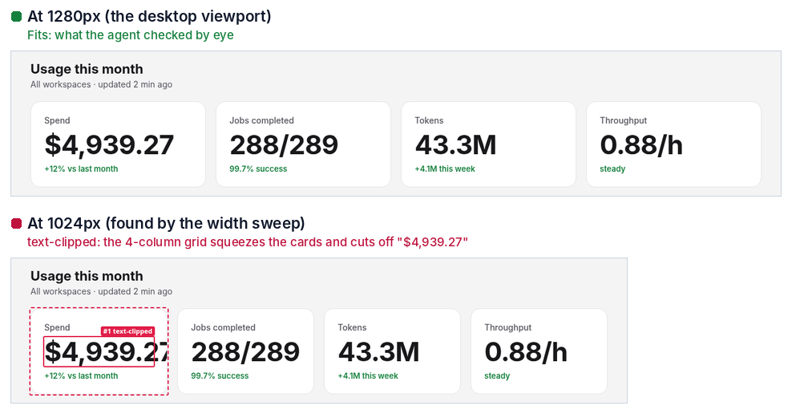

## How it compares

renderlint doesn't replace your other tools. It covers the gap between "the code is valid" and "the page looks right".

| | Reads | Catches overflow, overlap, clipping | Contrast over gradients and images | Needs a baseline | Tells you the fix |
|---|---|---|---|---|---|
| **ESLint, stylelint, TypeScript** | Source code | No | No | No | Yes, for code issues |
| **axe-core, Lighthouse** | DOM and computed CSS | No | Reported as "needs review" | No | Yes, for a11y rules |
| **Visual regression** (Percy, Chromatic, BackstopJS, Playwright screenshots) | Pixels, against approved images | Only as a diff from the baseline | Only as a diff | Yes: a defect in the first version becomes the baseline | No: shows *what changed*, not *what's wrong* |
| **renderlint** | Rendered geometry and pixels | Yes, at every width and with stressed content | Yes, from the real pixels behind each glyph | No | Yes: element, source file, screenshot and fix |

Visual regression testing is still the right tool for catching unintended *changes* to a design you've approved. renderlint catches defects in a page nobody has approved yet, which is what an agent produces every time.

## Does it work?

We ran 22 headless Claude Code sessions (Opus and Haiku), each building a typical frontend (landing pages, dashboards, a kanban board, a weather app, an SVG org chart, analytics charts) in HTML, React, Next.js, Vue and Svelte. Half of them also got the one-line setup prompt above.

- The **11 baseline apps had 229 errors** between them: mostly WCAG contrast failures, plus emoji icons and clipped chart labels.
- **All 11 apps built with renderlint finished at 0 errors**, because the agents fixed the issues themselves.

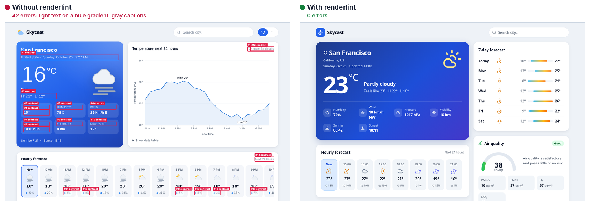
<p align="center"><sub>The same weather-app prompt in two sessions. Left: no renderlint, 42 errors. Right: the session that ran renderlint and fixed its own findings.</sub></p>

Per-app numbers and lessons: [docs/results.md](docs/results.md).

## Every page, every role, behind a login

**Every page.** renderlint reads your routes from source without running the app: Next.js (`app/` and `pages/`), Nuxt, SvelteKit, Astro, React Router 7 and Remix, TanStack Router, Angular, Vue Router. Dynamic routes such as `/products/:id` are filled with real values (`generateStaticParams`, the build manifest, crawled links, ids from your API). Hundreds of URLs become a few dozen routes: every URL gets a quick check and two per route get the full one, and every route ends up in a coverage report so none is skipped silently. `npx renderlint routes` lists what it found.

```
◐ Coverage 412 URL(s), 38 route(s): 35 checked, 2 need a role, 1 need param values
  needs a role /admin/users  app/admin/users/page.tsx — the page says "Access denied"
  needs param values /reports/:id  app/reports/[id]/page.tsx — no value for :id (…set "params")
```

**Behind a login, with no backend.** Give renderlint the token your route guard reads and mock the API, and inner pages render with nothing but the dev server running:

```json
{
  "pages": ["/dashboard", "/accounts"],
  "auth": { "storage": { "sessionStorage": { "acme.token": "test-token" } } },
  "mock": { "**/api/me": { "name": "Dana" }, "**/api/accounts": "fixtures/accounts.json" }
}
```

It can also log in through your form, or run a script for SSO. Server-rendered apps (Next.js, Nuxt, SvelteKit, Remix, Angular SSR) get the same `mock` on the server, so `middleware.ts` and loaders run too. With `"roles": { "admin": {…}, "viewer": {…} }`, every page is checked as each role. A page that only showed the login form or "Access denied" is reported, never passed. See [authentication](docs/authentication.md), [roles and coverage](docs/roles-and-coverage.md) and [server mocks](docs/server-mocks.md).

**WordPress and Elementor.** Point it at any WordPress site (wp-env, LocalWP, DDEV, Lando, Docker Compose). It crawls the real pages, scans your PHP templates, and names the Elementor widget with a link to the editor. See [docs/wordpress.md](docs/wordpress.md).

renderlint never sends credentials anywhere, never opens log-out or destructive links, and its server mocks only run on a loopback address. See [security](docs/security.md).

## Make it impossible to ship defects

renderlint exits non-zero when it finds errors, so you can gate any step on it:

| Where | How |
|---|---|
| **`npm run build`** | `init` appends a check to your build script, e.g. `"build": "vite build && renderlint dist"` |
| **Vite** (React, Vue, Svelte, Solid, Preact, Lit, Qwik…) | `import renderlint from '@yitec/renderlint/vite'` and add `renderlint()` to `plugins`. `vite build` fails on errors; in dev, an overlay shows findings live with source file:line. |
| **Claude Code** | `init` adds a `Stop` hook (`npx renderlint hook`): Claude can't end its turn while UI errors remain in files it changed. It only runs when UI files changed and gives up after 4 attempts. |
| **Other agents** | `init` writes the workflow into `AGENTS.md` (Codex, Cursor, Copilot, Gemini, Amp, Zed…) and `CLAUDE.md`, and installs three [skills](docs/agents.md): set up every page and role, fix findings, Playwright and Storybook. |
| **Playwright Test** | `withRenderlint(test)` checks each state your e2e tests reach. See [docs/playwright.md](docs/playwright.md). |
| **Storybook** | `renderlint storybook` checks every story. See [docs/storybook.md](docs/storybook.md). |
| **CI** | `npx renderlint --format github` gives inline PR annotations. See [docs/integrations.md](docs/integrations.md). |

<details>
<summary><b>What <code>init</code> does</b></summary>

1. Adds renderlint as a dev dependency (creating a `package.json` for plain HTML sites).
2. Writes `renderlint.config.json`, pointed at your dev command or static folder.
3. Adds a `lint:ui` script and appends the check to `build` (`--no-build` to skip).
4. Installs the agent skills `renderlint-setup`, `renderlint-fix` and `renderlint-e2e` in `.claude/skills/` (`--no-skills` to skip).
5. Adds the agent workflow to `AGENTS.md` and `CLAUDE.md`.
6. Installs the Claude Code Stop hook in `.claude/settings.json` (`--no-hook` to skip).
7. Adds `.renderlint/` to `.gitignore` and makes sure a headless Chromium is available.

`init` is idempotent: run it again to update the skills it installed.
</details>

## Adopting it on an existing app

An app that already has 200 findings can't go from red to green in one commit. Accept today's findings, then fail only on new ones:

```bash
npx renderlint baseline     # writes renderlint-baseline.json: commit it
npx renderlint              # known findings are counted, not shown; new ones fail the run
```

```
Since the last run: 3 fixed, 1 new.
187 known finding(s) in renderlint-baseline.json not shown (--no-baseline shows them).
4 finding(s) in renderlint-baseline.json are fixed: run `npx renderlint baseline` to drop them from the file.
✖ 1 error(s), 0 warnings
```

Every run compares itself with the previous one, so you and your agent see progress ("3 fixed, 1 new") even without a baseline. Agents are told never to rewrite the baseline themselves. See [configuration](docs/configuration.md).

## Intentional? Say so.

Sometimes low contrast or clipped text is on purpose: a watermark, a teaser, a chat message containing emoji. Mark it the way you'd write `eslint-disable`:

```html
<div data-renderlint-ignore="emoji" data-renderlint-reason="user-generated chat">…</div>
<p data-renderlint-ignore>…</p>                          <!-- all rules, this subtree -->
```

```css
.watermark { --renderlint-ignore: contrast; }            /* works from CSS, inherits */
```

Or in config, by selector or page: `"ignore": [{ "rule": "contrast", "selector": ".legal" }, { "rule": "dead-link", "page": "/blog/*" }]`. The agent instructions tell agents to fix root causes first and to give a `data-renderlint-reason` whenever they ignore something.

## Configuration

`renderlint.config.json` (or `.js`/`.mjs`, or a `"renderlint"` key in `package.json`):

```json
{
  "serve": "npm run dev",
  "pages": ["/", "/pricing"],
  "viewports": [375, 768, 1280],
  "rules": { "line-length": "off", "tap-target": "error" },
  "ignore": [{ "rule": "contrast", "selector": ".legal-footnote" }],
  "states": [{ "name": "account menu", "click": "[aria-label=Account]", "waitFor": "[role=menu]" }],
  "mock": { "**/api/notifications*": [] }
}
```

All options: [docs/configuration.md](docs/configuration.md).

## How it works

1. **Render.** Each page loads in headless Chromium at each viewport (and in dark mode if your CSS supports it). renderlint scrolls to trigger lazy content, waits for fonts and images, and jumps animations to their final state.
2. **Measure.** An analyzer runs in the page and checks geometry: every text run against its containers and clip boxes, box intersections, hit-testing for occlusion, computed styles.
3. **Look at the pixels.** For contrast, the page is captured twice, once with all text made transparent, so the real background behind each glyph is known, including gradients, images and glass effects.
4. **Drive it.** It opens each menu, hovers each tooltip, walks the page with Tab and Shift+Tab, and turns the mouse wheel over boxes that look stuck.
5. **Stress.** The layout rules run again at the sweep widths and with longer text, long words, bigger numbers and longer API data. Anything that only breaks under stress becomes a `fragile-layout` warning.
6. **Report.** Findings are merged across viewports and pages, repeats are grouped, and each is mapped back to a component file where possible (React, Vue, Svelte, Astro dev builds), with a fix hint and a numbered screenshot.

Everything runs on your machine: no telemetry, and the only network traffic is to the app you check (plus a one-time Chromium download). Details: [security](docs/security.md).

It's tuned for a low false-positive rate. Things that are usually intentional are left alone: screen-reader-only text, `text-overflow: ellipsis`, `line-clamp`, closed accordions, off-canvas menus, carousels, scroll areas, avatar stacks, badges positioned outside cards, stretched links, modals and backdrops.

```js
import { check, formatPretty } from '@yitec/renderlint';

const result = await check({ targets: ['http://localhost:5173'], config: { viewports: [390, 1440] } });
console.log(formatPretty(result));
process.exit(result.ok ? 0 : 1);
```

## Limitations

- `<canvas>` charts (Chart.js, ECharts in canvas mode) are pixels, so their labels can't be inspected. Use an SVG renderer.
- Pages are checked as they load, with each menu opened. Other states (dialogs, tabs, filled forms) are linted when you list them in `states` or reach them in a [Playwright test](docs/playwright.md).
- `--ux` clicks one control of each kind per page (at most 12), each on a fresh load: about a minute per page. It doesn't use hover menus or drag and drop.
- Server mocks are Node only. Pages a Django, Rails, Laravel or Go server renders need a running backend ([other backends](docs/frameworks/other-backends.md)).
- Contrast follows WCAG 2 AA math, not APCA.
- A page takes about 4–10 seconds at three viewports with the sweep and stress passes. Use `--sweep 1024` or `--no-sweep` for a faster inner loop.

## Contributing

```bash
npm install
npm test                  # every rule must fire on its defect page and stay silent on clean pages
npm run build:client      # regenerate dist/ after changing src/analyzer or src/client
node bin/renderlint.js test/fixtures/defects/contrast.html --no-crawl
```

See [CONTRIBUTING.md](CONTRIBUTING.md). MIT licensed. Website: [renderlint.yitec.net](https://renderlint.yitec.net). Mirror: [gitlab.com/anhnn.a05/renderlint](https://gitlab.com/anhnn.a05/renderlint).

## Star history

<a href="https://star-history.com/#ngocanhnckh/renderlint&Date">
  <picture>
    <source media="(prefers-color-scheme: dark)" srcset="https://api.star-history.com/svg?repos=ngocanhnckh/renderlint&type=Date&theme=dark">
    
  </picture>
</a>
