# Gallery

Every renderlint run saves annotated screenshots to `.renderlint/screens/`. Each finding is boxed and numbered to match the text report, so a coding agent with vision (or a person) can see exactly what is wrong. The images below are crops of those screenshots.

## Text that doesn't fit its box

The most common and most annoying class of UI bug: it throws no error, passes every test, and looks fine on the screen it was built on. Each tile is a crop of renderlint's annotated screenshot. They come from the [demo page](../examples/demo/index.html), the [KPI example](../examples/kpi-sweep/index.html), two apps built in the [agent experiments](results.md), and an Elementor page ([WordPress](wordpress.md)).

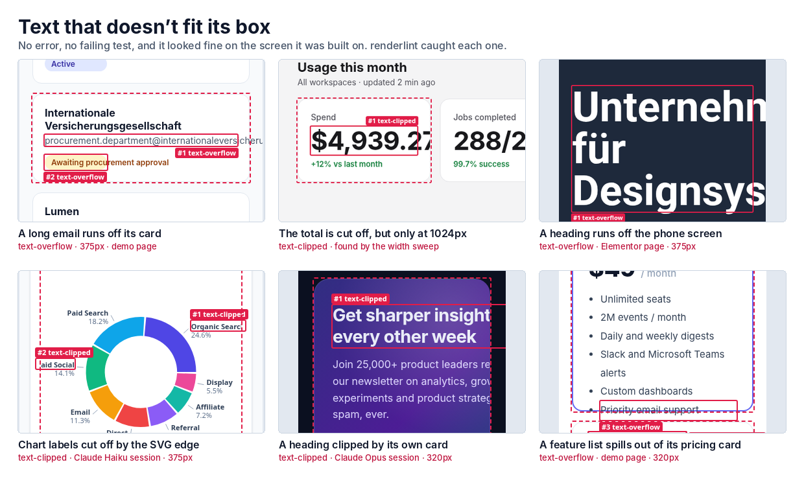

## Same prompt, with and without renderlint

Each pair comes from two separate headless Claude Code sessions given the same app prompt. The left session got only the prompt. The right one also got the one-line renderlint setup prompt from the README, and fixed its own findings until the check passed. Details: [results.md](results.md).

**Weather app (Svelte 5, Claude Opus).** The baseline used pale blue-white text on a blue gradient: 42 contrast errors across light and dark mode.

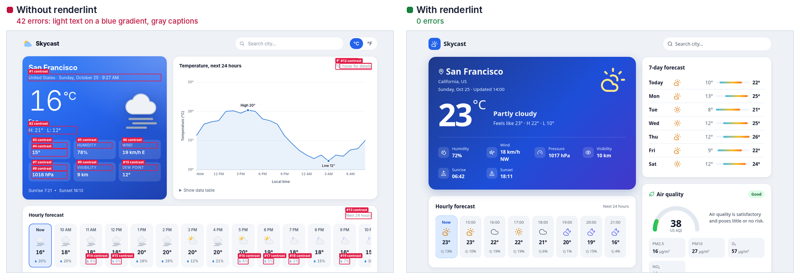

**Store dashboard (React + recharts, Claude Opus).** Gray chart axis ticks, a white-on-blue badge and button, and a gray sidebar heading: 28 errors.

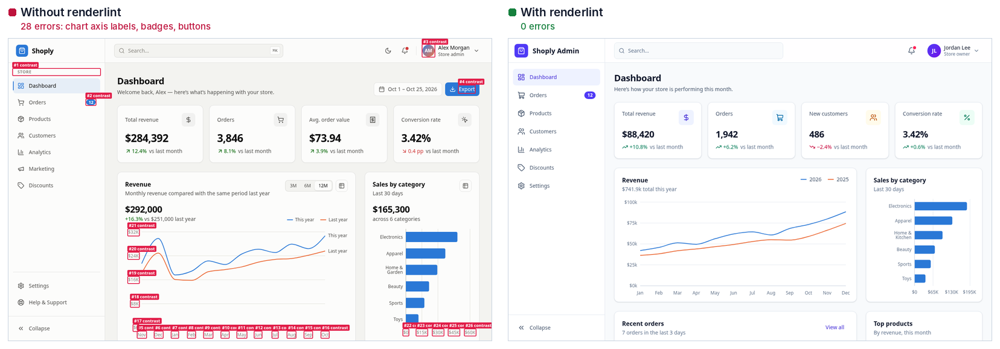

**Marketing analytics (React + recharts, Claude Haiku).** At 375px the donut labels "Organic Search" and "Paid Social" run off the edge of the SVG. The renderlint session wrapped the labels so they fit.

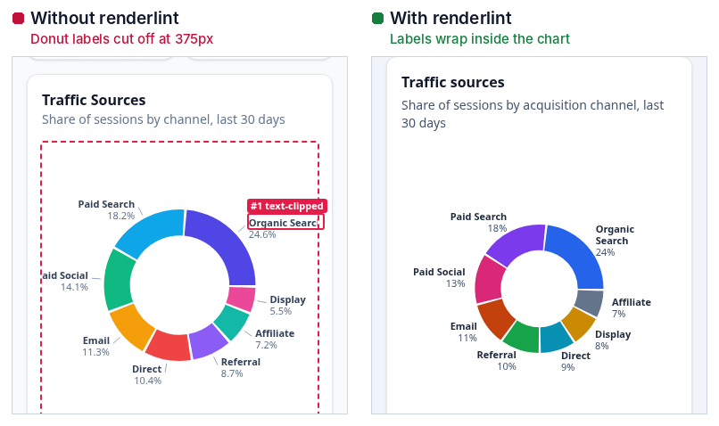

## Every rule on one page

[`examples/demo/`](../examples/demo/index.html) is a deliberately broken SaaS page, written to contain the mistakes agents typically make. Run it yourself from a checkout of this repo:

```bash
npm install
node bin/renderlint.js examples/demo
```

It reports 50 errors and 13 warnings across 22 rules. Some of them:

### Text that is longer than the design expected

The most common layout bug in agent-built UIs is that the sample copy fits, then real data doesn't. Here an account card gets a long company email with no break points. It runs out of the card and disappears under the next one. A status label in a fixed-width chip spills past the pill. Nothing errors, and a screenshot at a glance looks almost fine.

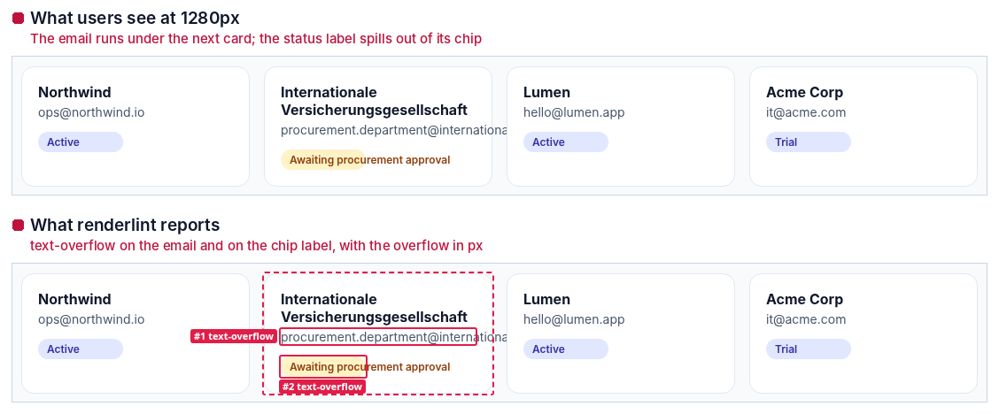

On a phone the same email runs off the card and off the screen:

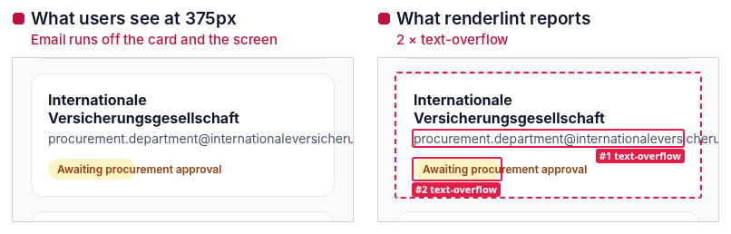

renderlint reports the exact overflow, for example `Text spills outside its container (61px past the right edge)`, with the fix: `overflow-wrap: anywhere` (Tailwind `break-words`) for long words and URLs, `min-width: 0` on flex and grid children, and no fixed widths on text boxes. It also reruns every page with stressed content (see [below](#widths-and-data-nobody-looked-at)). Layouts that only fit the current sample copy are reported as `fragile-layout` warnings before real data breaks them.

### Widths and data nobody looked at

An agent checks its work at a phone, a tablet and a desktop width. This KPI row fits at all three. Between 901px and about 1160px, though, the four-column grid squeezes the cards and the spend figure is cut off. renderlint sweeps 13 widths between 320 and 1920px with the layout rules, so the bug turns up at 1024px with its own screenshot. The page is [`examples/kpi-sweep/`](../examples/kpi-sweep/index.html).

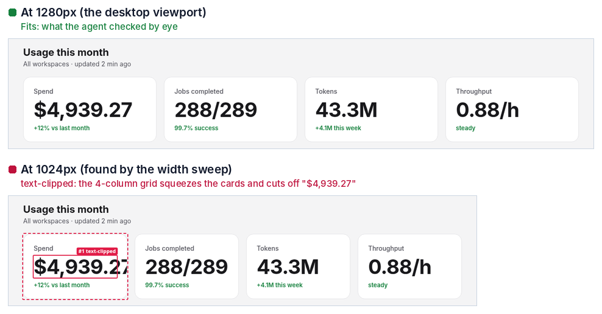

It then reruns the page with content that hasn't shown up yet: numbers with three more digits, 50% longer text, 36-character emails and IDs with no break points, longer strings in every JSON API response, and any worst case you declare with `data-renderlint-maxlength` or `data-renderlint-sample`. Whatever breaks is reported as `fragile-layout`:

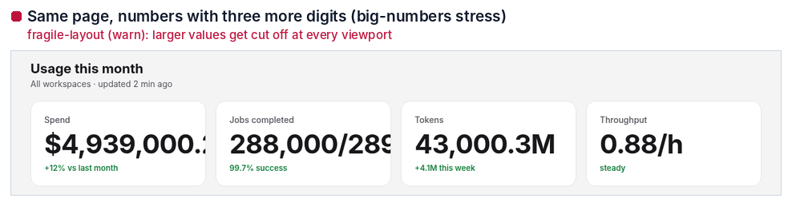

### Form controls that render but are built wrong

Nothing here is broken in the DOM sense, and the page looks fine at a glance. It just looks unfinished:

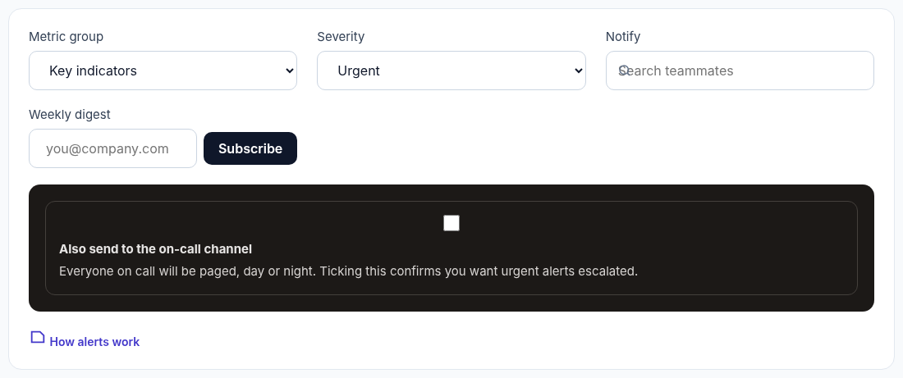

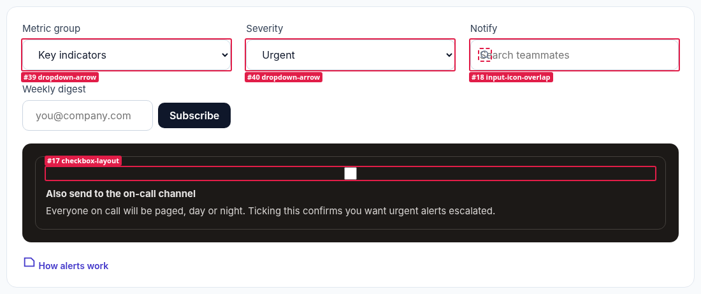

- **`dropdown-arrow`**: the selects have `padding: 0 20px`, but Chrome and Safari draw the native arrow about 3px from the border regardless of `padding-right`. renderlint measures the arrow from pixels (`3px from the right border while the text starts 25px from the left`), so it also catches `background-image` chevrons and custom triggers.
- **`checkbox-layout`**: a global `input { width: 100%; display: block }` meant for text fields also hits the checkbox. The browser draws the box in the middle of the full-width input, on its own row above the label.
- **`input-icon-overlap`**: the search icon is positioned at `left: 14px`, but the input only has `padding-left: 14px`, so the placeholder starts underneath the icon.
- **`control-height-mismatch`** (warning): the email field is 48px tall and its Subscribe button 40px.
- **`icon-misaligned`** (warning): the 22px document icon sits 6px above the center of the 14px link text.

Warnings are listed in the report. The screenshot only boxes errors when a page has any.

Also covered: **`squashed-control`**, an input or select too short for its font, so the text is clipped or pressed against the border.

### More from the demo page

| | |
|---|---|
| 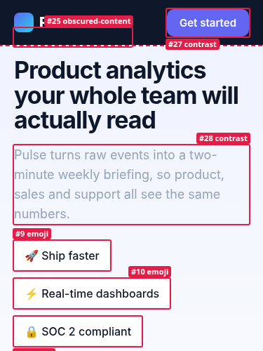 | **Phone, 375px.** The fixed header covers the "New" pill (`obscured-content`). The hero copy is `#94a3b8` on a near-white gradient, 2.35:1 (`contrast`). The feature list uses emoji as icons (`emoji`). |
| 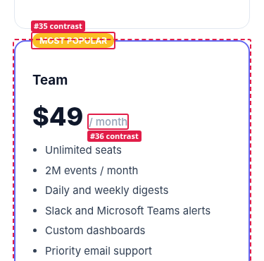 | **Phone, 375px.** The "Most popular" badge is white on amber, 1.67:1. The fixed-height card can't hold six features, so its CTA is pushed into the next card, where it is hidden (`content-overflow`, `element-overlap`, `obscured-content`). The button's fixed width cuts off its own label (`text-clipped`). |
| 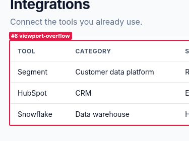 | **Phone, 375px.** A 680px table without a scroll wrapper makes the whole page scroll sideways (`viewport-overflow`). |

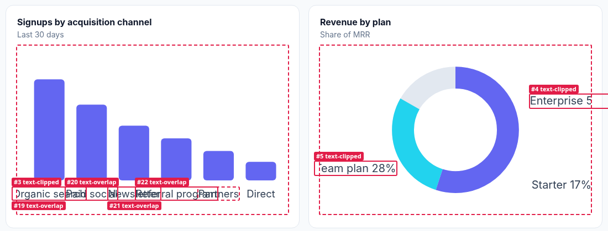

**Desktop, 1280px.** Bar-chart labels collide (`text-overlap`). Donut labels and the first axis label are cut off by the SVG edge (`text-clipped`).

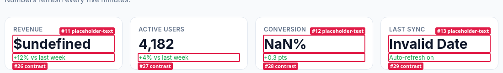

**KPI tiles wired to API data of the wrong shape:** `$undefined`, `NaN%`, `Invalid Date` (`placeholder-text`). The green deltas are 3.30:1 (`contrast`).

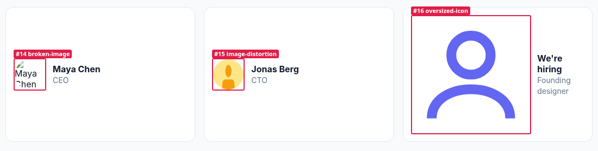

**Team cards:** a 404 avatar (`broken-image`, `broken-resource`), a 2:1 image forced into a circle (`image-distortion`), and a 24×24 icon with no size that grows to 204px (`oversized-icon`).

## Live in the dev server

With the Vite plugin, findings appear in a corner overlay while you work. Hovering a finding highlights the element, and each one links back to the component file and line. The same list prints in the dev-server terminal, where coding agents read logs.

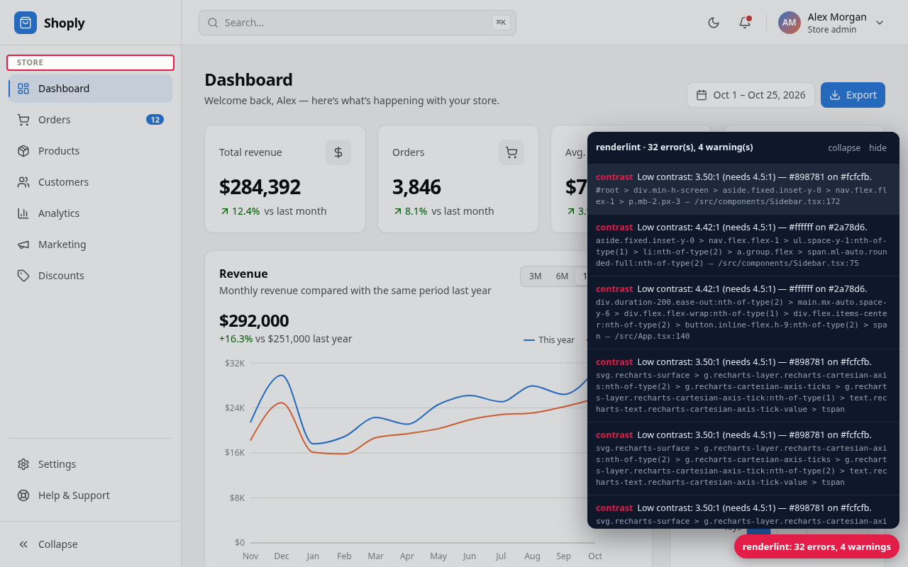
