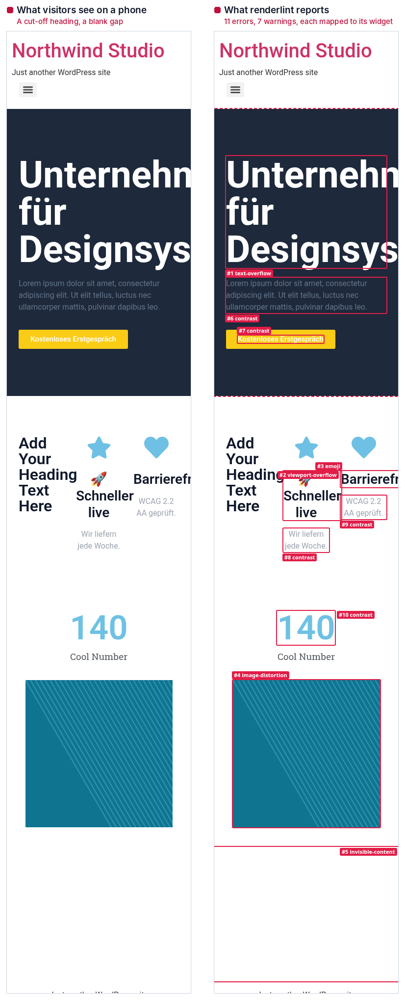

# WordPress and Elementor

renderlint checks the pages your WordPress site renders, so it works the same for a classic PHP theme, a block theme, a plugin, an Elementor or block-editor page, or a whole site you only have a URL for. It knows a few WordPress specifics on top of the usual rules:

- **Findings point at the Elementor widget** that produced them, with the page or template it lives in and a link to open it in the Elementor editor. Block-editor content names the block and its template part.
- **Theme and plugin templates are scanned too**: emoji and lorem ipsum in `*.php`, `template-parts/`, `parts/`, `patterns/`, `templates/`, `inc/` and similar are reported with file and line.
- **Content Elementor never revealed is reported**. An entrance animation whose script never ran (very often because an optimisation plugin delays JavaScript) leaves a blank gap with the content still `visibility: hidden`.
- **Leftover defaults are reported**: "Just another WordPress site", "Hello world!", "Sample Page", the sample comment, and Elementor's default widget texts ("Add Your Heading Text Here", "Cool Number", a "Click here" button…).
- **The crawl skips WordPress plumbing**: `wp-admin`, `wp-login.php`, feeds, REST URLs, `?replytocom=`, and links with side effects such as log out or add to cart. It checks two of each kind of post, archive and pagination page, so the page budget goes to pages with their own layout.
- **Counters are measured at their final value**, not halfway through counting up, and the admin toolbar of a logged-in session is ignored.



```
✖ text-overflow (1)  Text spills outside the box (card, button, badge, input) that is supposed to contain it.
  error Text spills outside its container (456px past the right edge).
        at div.elementor-element.elementor-element-99731bd > h1.elementor-heading-title  "Unternehmensberatung für Designsysteme"
        in Elementor heading 99731bd in page #12 — edit: http://localhost:8888/wp-admin/post.php?post=12&action=elementor
        page /beratung/ · all viewports · see .renderlint/screens/beratung-1mbb1@375.png #1
…
How to fix
  text-overflow: Let the text wrap: remove fixed widths/heights or `white-space: nowrap`, add `overflow-wrap: anywhere` …
    In Elementor: switch the editor to Mobile/Tablet view and set a smaller size there (Style > Typography > Size), …
```

## Quick start

### Theme or plugin repository

Run the setup in the theme or plugin folder (or ask your coding agent to, with the prompt from the [README](../README.md#quick-start)):

```bash
npx -y github:ngocanhnckh/renderlint init
npx renderlint
```

renderlint recognizes a theme (`style.css` with a `Theme Name:` header), a plugin (a PHP file with a `Plugin Name:` header) or a site (`wp-config.php`, `wp-content/`). PHP renders the pages, so it then looks for the local site in this order:

| Local environment | Where renderlint looks |
|---|---|
| [wp-env](https://developer.wordpress.org/block-editor/reference-guides/packages/packages-env/) | `.wp-env.json` → `http://localhost:8888` (or its `port`). Starts it with `npx wp-env start` if it isn't running. |
| DDEV | `.ddev/config.yaml` → `https://<name>.ddev.site` (`ddev start`) |
| Lando | `.lando.yml` → `https://<name>.lndo.site` (`lando start`) |
| Docker Compose | the published port of the `wordpress` image service (`docker compose up -d`) |
| LocalWP | a theme inside `Local Sites/<site>/app/public` → `http://<site>.local` |
| `wp-config.php` | `WP_HOME` or `WP_SITEURL`, if defined |
| Anything else | `localhost:8888`, `:8080`, `:8000`, `:80`, `:10003`–`10005` |

Self-signed certificates (LocalWP, DDEV, Lando, mkcert) are fine. If your site lives somewhere else, MAMP, XAMPP or a staging server for example, set `url` in `renderlint.config.json` or pass it: `npx renderlint https://mysite.local`.

`init` writes the config, adds the workflow to `AGENTS.md`/`CLAUDE.md` (with WordPress notes for agents) and installs the Claude Code Stop hook. The hook re-checks when PHP, Twig, Blade, CSS, JS or `theme.json` files change. It doesn't touch your `build` script, because a WordPress build doesn't serve pages.

### A site you only have a URL for

Elementor sites are often built without a code repository. Point renderlint at the site:

```bash
npx -y github:ngocanhnckh/renderlint https://staging.example.com --max-pages 30
npx -y github:ngocanhnckh/renderlint https://staging.example.com/pricing/ https://staging.example.com/contact/ --no-crawl
```

Every finding in Elementor content carries the editor link, so you can open the widget and fix it.

> [!WARNING]
> Check a local copy or a staging site rather than production when you can. renderlint only loads pages and never submits forms, but it does load every page it crawls at several widths.

## Configuration for WordPress

```json
{
  "url": "http://localhost:8888",
  "serve": "npx wp-env start",
  "pages": ["/", "/services/", "/pricing/", "/contact/", "/blog/"],
  "maxPages": 30,
  "exclude": ["/tag/*", "/author/*"],
  "ignore": [{ "rule": "dead-link", "selector": ".elementor-location-footer" }]
}
```

- List the pages that matter in `pages`, especially landing pages that aren't in a menu. The crawler follows links from there.
- `exclude` takes path globs. WordPress system URLs are already skipped.
- `ignore` with a selector silences findings in one area, such as a third-party widget you can't change. In Elementor you can also add `data-renderlint-ignore` through the widget's Advanced > Attributes (Pro) or a CSS class with `--renderlint-ignore: <rule>;` in custom CSS.

### Logged-in pages, WooCommerce account and checkout

renderlint can log in through `wp-login.php` once and check the pages as that user:

```json
{
  "auth": { "login": "/wp-login.php", "user": "${RENDERLINT_USER}", "password": "${RENDERLINT_PASSWORD}" },
  "pages": ["/my-account/", "/cart/", "/checkout/"]
}
```

Use a customer test account rather than an administrator (wp-env's default is `admin` / `password`), and keep the password in an environment variable. See [authentication](authentication.md) for other ways in. The admin toolbar that appears for logged-in users is ignored. Put something in the cart first with a `states` entry (see [configuration](configuration.md#states-and-mocks)), for example `{ "name": "cart with a product", "page": "/shop/", "click": ".add_to_cart_button", "waitFor": ".added_to_cart" }`.

## Fixing what it finds in Elementor

Elementor stores page content in the database, not in files, so most fixes happen in the editor. The report adds an "In Elementor:" line to the fix hints when a finding comes from an Elementor widget. The most common ones:

| Finding | Usual cause in Elementor | Fix |
|---|---|---|
| `text-overflow`, `viewport-overflow` on phones | Font size and widths set for desktop only | Switch to the Mobile view in the editor and set Typography > Size there. Replace fixed px widths with % or Full Width, and set containers to Direction: Column on mobile. |
| `contrast` | Elementor's default global colors: Primary `#6EC1E4` and Text `#7A7A7A` both fail on white | Fix the Global Colors once in Site Settings, or the widget's Text Color |
| `invisible-content` | An entrance animation whose script never ran | In WP Rocket, Perfmatters, LiteSpeed or similar, exclude Elementor's frontend scripts and jQuery from "delay JavaScript". Otherwise check the browser console for errors, or remove the animation. |
| `placeholder-text` | A widget dropped in and never edited | Replace the default text |
| `image-distortion` | Image widget with both Width and Height set | Leave Height on auto, or set Object Fit to Cover |
| `dead-link` | A button whose Link field is empty or `#` | Set the link, or remove the button |
| `focus-indicator` | Accordion and tab titles with no focus style, under a theme that doesn't add one | Add a `:focus-visible` outline in the theme or site CSS |

## CI

With wp-env, a theme or plugin can be checked on every pull request:

```yaml
# .github/workflows/ui.yml
name: UI
on: [pull_request]
jobs:
  renderlint:
    runs-on: ubuntu-latest
    steps:
      - uses: actions/checkout@v4
      - uses: actions/setup-node@v4
        with: { node-version: 20 }
      - run: npm ci
      - run: npx wp-env start
      # Content for the pages you check: a WXR export, a DB snapshot, or WP-CLI commands
      - run: npx wp-env run cli wp plugin install wordpress-importer --activate
      - run: npx wp-env run cli wp import wp-content/themes/my-theme/tests/content.xml --authors=create
      - run: npx renderlint --format github
```

Elementor content is in the database, so CI needs the content too. A theme usually ships demo content (WXR) for this. For an Elementor site, import a database snapshot from staging (`wp db export` / `wp db import`) or run renderlint against the staging URL after each deploy.

## Static exports

If you publish a static copy (Simply Static, WP2Static), check the export folder like any static site: `npx renderlint ./static-export`.

## Limitations

- Classic PHP templates aren't mapped to a file and line in the rendered findings. A finding gives the element's selector, the Elementor widget or the block. Emoji and placeholder copy in templates are found with file and line by the source scan.
- Elementor Pro theme-builder headers, footers and popups are reported with the template's post id and an editor link, like pages.
- The checks run on the pages as an anonymous visitor sees them, unless you pass a logged-in session.
